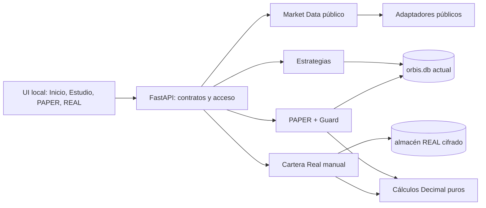

# Arquitectura de Orbis v0.2

**Estado:** aplicación local con LAB, PAPER y libro REAL; MEXC, GRVT y DEX BNB tienen recorridos verificados con proveedores controlados. Estado vigente y brechas: [aceptación funcional](ACEPTACION_FUNCIONAL.md) y [progreso](PROGRESO_V0.2.md). El piloto humano mainnet sigue pendiente.  
**Especificación:** [ORBIS_ESPECIFICACION_V0.2.md](ORBIS_ESPECIFICACION_V0.2.md).  
**Plan:** [PLAN_TRANSICION_V0.2.md](PLAN_TRANSICION_V0.2.md).

## 1. Decisiones y motivos

v111 incorpora [PAPER manual gráfico](MANUAL_PAPER_GUI_PLAN.md): runtime local
con engine SQLAlchemy estable, modo de archivo explícito, comprobación de
conexiones e intención de autenticación revocable. Crear publica un esquema
cifrado completo; proteger libera conexiones/lease sólo tras drenar Uvicorn,
usa la migración verificada y vuelve bloqueado al mismo puerto. Un trabajo
propio comparte exclusión con los otros cuatro almacenes sin cambiar su scope.
La contraseña no se persiste y sus errores no repiten el cuerpo introducido.
No hay cambio del esquema financiero ni cifrado automático de archivos legados.

v110 verificado/cargado: [activación perpetua](GRVT_PERP_BOT_ACTIVATION.md) con
revisión/MAC de un uso, capacidad original sólo RAM, replay al activar, seed
actual y coordinador de supervisión v5. La GUI conserva los dos modelos y
consulta capacidades del backend. Suite de 4.790 casos y quince recorridos
actuales, con corrección aislada de una expectativa de recursos sin cambiar
la aplicación. Smoke local sin abrir REAL y 51 rutas privadas protegidas.
El objetivo global permanece abierto.

Incorporado en v110: [supervisión y coordinador perpetuo v5](GRVT_PERP_SUPERVISION.md).
Compone el servicio MAINNET existente con el productor independiente, salidas
exactas sobre fills y bid/ask, vigilancia privada y conciliación. Los
checkpoints se recalculan, y la caché comprueba las filas enlazadas originales.
Se conecta a la revisión y activación API/GUI nuevas. A continuación se conserva
la evolución anterior y sus diferencias de contrato.

v109 incorpora [señales REAL independientes](GRVT_PERP_SIGNALS.md) y una
[concesión perpetua v4](GRVT_PERP_BOT_GRANT.md): origen LAB/PAPER reproducido,
seed sin operaciones históricas, trabajador revocable y escritor cifrado.
SELECT fija señal y plan REAL antes del nuevo claim v3 y de la transmisión.
Se comparte la reserva de subcuenta y se conservan lectores v1–v3, sin migración
SQLite. Un prefijo RAM acotado revalida bytes/metadatos y evita repetir los
indicadores; bloquear lo descarta. Funding puede enlazarse al grupo numérico
de fills sólo en claim v3. En ese corte faltaban el coordinador nuevo,
vigilancia de posición/costes, salidas compatibles y revisión/activación GUI;
quedan integrados y verificados en v110.

El [núcleo de entrada perpetua REAL](GRVT_PERP_ENTRY_KERNEL.md), verificado/cargado en v108,
separa presupuesto REAL, plan Decimal y preflight de los contratos anteriores.
Reutiliza el libro de reservas, firma y límite de transmisión durable. El nuevo
claim v2 conserva inputs y formato propio; v1 sigue leyéndose por su contrato.
No crea tablas ni una ruta de activación. El coordinador de señales/permisos/
salidas y la GUI del bot nuevo se incorporan posteriormente en v110.

v107 (cargado y verificado) añade una [revisión de derivados para REAL](PERP_REAL_REVIEW.md): reproduce
LAB/PAPER originales y compara dos lecturas privadas del margen/apalancamiento
por instrumento. Fija un prefijo y comprueba el dataset LAB real, descarta
autoridad de cierres estimados y exige presupuesto REAL separado. HTTP sin
mutex REAL ni transacción, con revocación por token/conexión/época. API y UI
compartidas, sin migración ni modificación del ejecutor anterior. La puerta de
ejecución se incorpora en v110 mediante otra revisión y autorización; una
coincidencia de esta comparación no la habilita.

v106 añade `perp_gap_close`/`format`/`store`/`export` como escenario separado,
con enlace al prefijo observado reproducido, fuente pública actual y resultados
condicionales de autoridad NONE. Los checkpoints siguen siendo sólo evidencia.
GRVT PAPER 14 añade una tabla de cierres; no modifica los eventos originales.
La lease compartida de cada cursor excluye el cierre entre procesos; el cierre
conserva su propiedad durante HTTP, liberando mutex y transacciones. Las épocas
y la identidad de cabecera se comprueban antes de publicar. Repetir un request
recupera el mismo resultado sin volver a cotizar.

La exportación compuesta conserva el JSONL original y añade un footer exterior.
El verificador original entrega su estado *calculado* mediante callback sólo
tras verificar su cierre/EOF; la estimación nunca decodifica una cuenta guardada.
Las marcas y métricas estimadas están separadas de las observadas. Motor/API/UI,
reapertura en otro proceso y regresión comprobados. La puerta REAL posterior
de v110 no admite estos cierres estimados como origen observado.
[Decisión](PERP_GAP_CLOSE_PLAN.md).

v105 (cargado y verificado) extrae a `security.local_session` la duración fija y
solicitud estricta de LAB/DCA/Spot/GRVT PAPER. Cada dominio conserva validación
SQLCipher, formato, publicación atómica y revocación existentes. La UI reutiliza
el campo y el formato de tiempo; no persiste una política larga. DCA conserva
su dependencia de LAB al comprar, cubierta con pruebas de caducidad de cada
clave. `pending_unlock` evita que verificar una contraseña fuera del mutex
resucite una clave después de bloquear: el token pendiente debe seguir vigente
al publicarla. Bloquear o una autenticación posterior lo cancela; el `finally`
sólo retira su propio token. No se bloquea el mutex durante SQLCipher.
No se cambia el calendario financiero ni los formatos publicados.
[Plazos y dependencias](LOCAL_OBSERVATION_SESSIONS.md).

v104 añade plazo explícito a creación/desbloqueo de GRVT PAPER, entre quince
minutos y treinta días. Se valida como entero estricto en API y conserva la
caducidad monotónica fija: leer no renueva, bloquear/reautenticar revoca épocas
y reabrir no recupera claves ni trabajadores. No cambia reglas financieras,
esquemas ni acceso a LAB/Spot/DCA/REAL. UI/API y regresión afectada verificados;
no es una prueba de duración real durante treinta días.

v103 conecta la reserva con revisión/activación desde LAB y reutiliza la misma
vista en Perpetuos PAPER. `perp_observed_view` selecciona datos calculados por
el replay, con ventanas acotadas y equity Decimal del libro compartido. Las
páginas anteriores vuelven a reproducir el snapshot fijado por secuencia/hash;
no restauran una cuenta desde el checkpoint. El gráfico conserva OHLC cerrado
y fills en series separadas, con precios/segundos reales de observación y ns
en el diario. La interfaz guarda sólo IDs inciertos, consulta antes de repetir
y no reactiva al reabrir. Cargado y verificado en v103; el archivo distingue
recogida de fuente y aceptación serializada con controles. La cobertura exige
recepción y precio vigentes. v104 resuelve el plazo fijo de quince minutos de ese corte, conservando
la interrupción y exposición incierta tras pérdida de cobertura. [Uso](PERP_OBSERVED_USAGE.md).

v99–v102, integrados en v103, conectan el libro compartido a puntos actuales
mediante `perp-observed-1.0`. `perp_observed_wire` separa fuentes estrictas de
checkpoints; `perp_observed_archive` guarda/repite inputs y permite un único
observador sobre cada cursor propio. GRVT PAPER 13 añade cuatro tablas sin
modificar las anteriores. Las épocas y las identidades HMAC impiden que
bloquear/reautenticar conserve una sesión activa o una copia adicional de su
contraseña en la caché. La copia online usa otro archivo ya cifrado y otra clave.
`perp_observed_source` consulta únicamente datos públicos; el trabajador recoge
fuera de SQL y conserva exposición/GAP al perder cobertura. Los puntos REST no
se anuncian como vigilancia continua. La interfaz y el recorrido en dos procesos están verificados en v103.
v102 añade coordinación y
API local: revisión de origen caducable, época PAPER fijada, activaciones
idempotentes, cancelación incluso anterior al POST y registros acotados. El
lifespan drena preparaciones/arranques/trabajadores antes de liberar leases;
no conecta sesiones guardadas al iniciar. Los controles de recepción del
servidor conservan el mismo input al repetir una solicitud. La cancelación
puede operar con PAPER bloqueado y no expone datos financieros en su respuesta.
[Diseño y brechas](PERP_OBSERVED_PLAN.md).

En v98, `perp_validation` conserva el motor publicado y genera cuentas
independientes para reserva cronológica, ventanas sucesivas y sensibilidad.
LAB 11→12 añade `perp_validations`: métricas y huellas de todos los resultados
hijos, sin duplicar sus diarios en el informe. Lectura/exportación recalculan
todos los hijos; **Ver** materializa una prueba real deduplicada y reutiliza el
gráfico. La inspección propaga la misma época entre perfil, run y reproducción.
`research.perp_reference` publica una referencia OOS tipada de autoridad NONE;
no modifica las referencias de precios ni los controles REAL anteriores.
[Decisiones y aceptación](PERP_VALIDATION_PLAN.md).

En v97, `perp_profile`, `perp_path`, `perp_execution_math` y
`perp_simulation` conectan el libro a una cronología histórica experimental.
`perp-ohlc-1.0` conserva trayectorias TRADE/MARK independientes, funding asentado,
costes, margen, liquidación y diario. Perfil/versión/datos se fijan por hash.
LAB 10→11 añade `perp_profiles`/`perp_runs`; `perp_experiments` calcula fuera del
bloqueo SQL y vuelve a comprobar originales, identidad y época de acceso antes
del commit. Detalle/exportación reproducen el resultado completo. El widget
reutilizable ofrece gráficos, marcas, métricas y paginación; no activa PAPER ni
REAL. El modo sólo admite reglas actuales e hipótesis intravela. v98 añade OOS
y v103 integra la continuidad PAPER observada.
[Decisión completa](PERP_EXPERIMENTS_PLAN.md).

En v96, el núcleo interno `perp-account-0.1` introduce estados inmutables y
transiciones sin I/O: libro de órdenes/posiciones, margen inicial/pre-trade,
funding asentado, liquidación completa y diario reconciliado. Decimal usa un
contexto propio y una política experimental explícita de 18 decimales. Las
órdenes y fills son eventos separados; MARK nunca se convierte automáticamente
en precio de ejecución. En esa entrega aún no estaba importado por las rutas
de la app. v97 añade perfil, planificación, archivo, reproducción e interfaz;
OOS se añade en v98 y la interfaz de PAPER observado en v103. El núcleo no
concede permisos REAL. [Aceptación del núcleo](PERP_BOOK_ACCEPTANCE.md).

En v95, `StorageProtection` coordina únicamente LAB/DCA/Spot PAPER/GRVT PAPER.
La API local redacta el cuerpo con contraseñas, fija archivos/ID y congela
nuevas operaciones. El lanzador conserva el socket, drena HTTP/trabajadores y
libera leases antes de usar los migradores existentes; después inicia otra
vida del mismo servicio. Contraseña y estado del trabajo viven sólo en memoria,
sin argumentos, entorno, fichero ni reconexión de bots. El cifrado es atómico
por archivo, con copias verificadas y resultado parcial explícito. REAL y PAPER
manual quedan excluidos. [Decisión y aceptación](CIFRADO_DESDE_AJUSTES_PLAN.md).

En v94 (cargada), LAB 10 añade `perp_datasets`: archivo compuesto de TRADE, MARK,
financiación y snapshots actuales, con tipos, cobertura y huellas verificadas.
No entra en los datasets de estrategias ni recrea permisos; su estado `NOT_RUN`
expresa que aún no hay backtest completo de margen. Los nanosegundos son texto.
Las lecturas LAB adjuntas de DCA comparten el conjunto explícito de versiones
compatibles; las versiones desconocidas se rechazan. Las copias verifican los
nuevos registros sin reinterpretar datos anteriores. La consulta pública completa
precede a toda escritura y se comprueba de nuevo el acceso/identidad de LAB.
El archivo requiere LAB cifrado; el legado local plano necesita una migración
con contraseña del propietario, disponible desde Ajustes en v95 para estos
cuatro almacenes. PAPER manual sigue offline. [Contrato y siguiente
tramo](DERIVADOS_HISTORICOS_PLAN.md).

En v93 (cargada), la renovación tras resultados recuperados usa contratos nuevos:
control v4, vínculo v3, material de renovación v2, LONG v6 y DCA v3. Conserva
los identificadores y hashes de hechos aceptados en el corte de la revisión;
ninguna aceptación futura justifica el pasado. Reconstruye posición y cuotas
acumuladas, incluye gas de cancelaciones/reversiones y conserva claves DCA
consumidas. STOP recuperado acredita la revisión de política por su efecto
verificado, sin modificar el recibo original. Los lectores históricos conservan
su semántica, incluida LONG v5, DCA v2 y resolución v1. No cambian SQL ni contrato.
La confirmación CONFIGURE y el rearme son decisiones explícitas separadas.
[Decisión y criterios](DEX_RECOVERED_RENEWAL_PLAN.md).

En v92 (cargada), la investigación DEX utiliza registros cifrados
independientes ligados por digest a los encabezados de vínculo y autorización.
El esquema 72 añade dos tablas; preserva la semántica de los diarios financieros
ya publicados y permite seleccionar otra reserva al rearmar sin perder posición
o presupuestos. La activación HTTP repite originales antes de conectar firma,
con una relectura final y persistencia atómica; el trabajador fija su digest en
RAM. Los registros guardados no recrean permisos. Señales MEXC BNB/USDT y ejecución
Uniswap USDT/WBNB conservan sus contextos separados. Decisión y límites:
[validación DEX](VALIDACION_OOS_PLAN.md#vínculo-dex--v92-cargada).

En v91 (cargada), `research.grvt_binding` repite LAB/backtest/PAPER y
conserva un prefijo observado estable. La revisión MAINNET v2 sella esa referencia;
la concesión v3 la archiva, manteniendo los lectores v1/v2 anteriores. Se releen
originales después de consultar los metadatos del proveedor y antes de conceder.
Los nanosegundos se normalizan como texto antes de hash/MAC para evitar cambios
al transportar JSON a través del navegador. El protocolo declara que el motor
histórico actual no modela margen/financiación. No cambia el esquema SQL ni los
contratos de órdenes, firma, conciliación o STOP. DEX requiere otra integración.

En v90, `research.mexc_binding` enlaza una validación repetida a cada nueva
autorización/rearme MEXC mediante `orbis.mexc.bot.research.v1`. Conserva el
origen PAPER, admite investigación anterior del mismo mercado y comprueba las
velas comunes. Una relectura tras la consulta de apertura impide confirmar
entradas cambiadas. Los snapshots se comprueban al leer la autorización; la
renovación continua conserva su evidencia y el rearme vuelve a los originales.
DCA registra el reinicio de referencia al activar y la mantiene al rearmar.
No cambia esquemas, motores ni formatos de permiso. Los pedidos antiguos sólo
se repiten de forma inerte; sus autorizaciones no se reinterpretan. Las puertas
GRVT y DEX aún requieren su propia integración versionada.

En v89, `lab.experiment_verification` comparte la repetición de experimentos sin
alterar su semántica publicada. `research.references` identifica con tipos,
ventanas y hashes las validaciones de versión fija LONG/SHORT y DCA. El protocolo
`orbis.research.reference.v1` exige reconstrucción contra originales locales y
declara autoridad NONE; no cambia formatos de bots, permisos ni esquemas.
`research-reference.js` aporta un componente de exportación usado por ambas
pantallas, con invalidación por selección/estado y descarte de respuestas tardías.
La [secuencia OOS](VALIDACION_OOS_PLAN.md) documenta el protocolo y la vinculación
REAL, integrada posteriormente en v90–v92, incluida la diferencia de
referencias de precio inicial DCA. La referencia conserva autoridad NONE.

| ID | Decisión para fase 1 | Motivo y límite |
| --- | --- | --- |
| A-01 | Mantener FastAPI/Python 3.14, SQLite y la UI local existentes durante la fase 1 | Ya funcionan mercado, gráficos y PAPER. Cambiar de pila antes de validar la cartera añadiría riesgo y duplicaría lógica. React/Tauri siguen como opción para una fase posterior, sujeta a prototipo. |
| A-02 | Crear **Cartera Real manual** en un módulo y almacén propios; conservar `operations.mode=LIVE` como legado sin clasificar | El modelo PAPER no representa aportaciones, transferencias ni ajustes de patrimonio. Ninguna fila `LIVE` actual se considerará real sin confirmación; la base examinada el 13-10-2026 no contenía filas `LIVE`. |
| A-03 | Usar un libro de eventos inmutable a nivel lógico y reconstruir posiciones desde él | Las correcciones se registran como eventos; se puede explicar el saldo y repetir cálculos. No habrá edición silenciosa de operaciones pasadas. |
| A-04 | Guardar importes y cantidades como texto decimal canónico en las tablas nuevas; calcular con `Decimal` en Python | SQLite no tiene un tipo decimal exacto nativo para el rango requerido. No se harán sumas monetarias mediante `float` ni agregados SQL que puedan perder precisión. |
| A-05 | Usar coste medio ponderado como métrica informativa de fase 1, con método identificado | Es consistente con PAPER, pero no se presentará como cálculo fiscal definitivo. El método debe versionarse antes de cambiarlo. |
| A-06 | Proteger el nuevo almacén con SQLCipher y contraseña introducida al desbloquear; mantener la clave sólo en memoria mientras esté abierto | La v0.2 exige cifrado local. La integración se valida en una base temporal antes de migrar datos. Sin contraseña válida no se montan rutas de lectura/escritura REAL. |
| A-07 | Versión de esquema explícita y backups cifrados comprobados antes de cambios de esquema | `create_all` sólo se usa al crear una bóveda nueva. Una versión desconocida bloquea la apertura sin modificar datos. La migración v1→v2 se realiza sobre copia cifrada, con preimagen, integridad y recuentos del libro antes del reemplazo. |
| A-08 | No conectar exchanges ni billeteras a Cartera Real en fase 1 | Su alcance es registro manual local. Los adaptadores de mercado siguen siendo públicos y de sólo lectura. |
| A-09 | Nuevos módulos con tipos explícitos y contratos pequeños; la UI obtiene cifras calculadas del servidor | Evita duplicar lógica financiera. La UI actual se conserva; nuevos componentes deberán ser reutilizables y tener estados de carga, vacío y error reales. |
| A-10 | Restaurar sólo copias gestionadas y cifradas con la clave de la bóveda abierta | Se valida integridad SQLite/SQLCipher, referencias y reconstrucción del libro; antes del reemplazo se preserva una copia cifrada del estado actual. La sesión se bloquea tras el intento. No se admiten rutas arbitrarias desde la UI. |
| A-11 | Preparar un adaptador de billeteras separado de Cartera Real manual; conexión de lectura antes de cualquier ejecución | MetaMask y Trust Wallet son orígenes optativos de activos. Saldos observados no se convierten en compras; conectar no concede permiso de gasto. El objetivo posterior es automatización real con límites y parada. |
| A-12 | Priorizar MEXC Spot, GRVT y un DEX EVM candidato (Uniswap) mediante adaptadores distintos | Se cubren capital en wallet, depósitos directos y saldo preexistente en exchange sin construir veinte conectores. GRVT no se tratará como MEXC Spot: su modelo de cuentas, firma y derivados exige motor de riesgo propio. |
| A-13 | Tratar DCA y LONG/SHORT como familias distintas que comparten dataset, versión de reglas y trazabilidad | DCA mide aportaciones, unidades y presupuesto; derivados miden exposición, colateral, financiación, margen y liquidación. Ni sus saldos ni sus métricas se agregan como si fueran equivalentes. Una estrategia sólo es candidata a REAL tras backtest reproducible, validación fuera de muestra, PAPER observado y límites/parada probados. |
| A-14 | Reutilizar un paso DCA puro para histórico y PAPER, con ejecución propia de cada entorno | La señal procede del cierre ya conocido. Histórico compra en la apertura siguiente; PAPER usa el ask público observado y marca la posición al bid, ambos como aproximaciones. Se fijan versión de regla, motor y huella de datos; una sesión con motor diferente o hueco queda detenida. No se infiere que la operación habría sido aceptada por MEXC. |
| A-15 | Observar sesiones PAPER DCA y señales GRVT con un planificador local reutilizable, dejando la ejecución de posiciones separada | La agenda se reconstruye desde SQLite al iniciar FastAPI. Un aviso concurrente al cálculo de espera no se pierde; las transacciones de dominio, no la hebra, evitan duplicados. Una señal no es una orden ni una posición. |
| A-16 | Calcular mantenimiento GRVT sólo como instantánea de riesgo en PAPER manual | Se consulta un mark y las reglas públicas actuales, incluida la deducción acumulada del tramo. El resultado no dispara liquidación: sin precios continuos ni financiación completa no puede reconstruir la secuencia real de riesgo. Las reglas ausentes u obsoletas bloquean la valoración. |
| A-17 | Ordenar causalmente las valoraciones y cierres de cada posición PAPER GRVT | Una cotización anterior al último evento se rechaza; observar dos veces el mismo tick devuelve el evento ya guardado salvo si entretanto se asentó funding y debe recalcularse el margen. Un mark distinto con la misma marca temporal es contradictorio. Se serializa la decisión dentro de la transacción, incluso con peticiones concurrentes. |
| A-18 | Separar consulta y asentamiento ficticio de financiación GRVT | La consulta pública no escribe. Un POST local con idempotencia asienta en PAPER sólo intervalos completos, conserva cada tasa/mark y corrige P/L cerrado si se registra después. El libro real de pagos GRVT y la liquidación del venue siguen fuera de alcance. |
| A-19 | Registrar las intenciones MEXC Spot en la bóveda REAL antes de cualquier futuro envío | Una transacción `BEGIN IMMEDIATE` serializa decisión y reserva entre procesos. El ID es idempotente; las reservas por activo se comparten entre símbolos de la misma cuenta. Una parada persistente rechaza nuevas intenciones y libera reservas aún no enviadas. El journal no transmite órdenes ni autoriza credenciales. |
| A-20 | Seguir estrategias LONG MEXC Spot en un libro PAPER propio por sesión | El evaluador de reglas LAB decide sobre velas cerradas; el asiento de caja/unidades y la evidencia se confirma en una transacción local. Un hueco detiene la sesión sin operación retroactiva. No se mezcla con la Cartera PAPER manual, GRVT ni REAL; no hay credenciales ni órdenes externas. |
| A-21 | Bloquear PAPER manual cifrado en el límite de acceso a SQLAlchemy | La clave expira a los 15 minutos en memoria. La dependencia de sesiones rechaza nuevas peticiones con 423 cuando está bloqueado y el bloqueo dispone el pool; la API de estado/desbloqueo queda disponible sin sesión. Una petición ya iniciada puede terminar. El legado plano no finge estar bloqueado. |
| A-22 | Respaldar PAPER cifrado sólo mientras su bóveda local está desbloqueada | Se exporta una instantánea SQLCipher consistente a un archivo nuevo con contraseña independiente, se reabre y se comprueban integridad, esquema, filas y huella lógica antes de publicarlo. No se reemplaza la base activa ni se conserva ninguna clave en disco. La restauración continúa siendo offline para no cambiar una base abierta. |
| A-23 | Aplicar las claves foráneas del Ledger PAPER en cada conexión SQLite/SQLCipher | El PRAGMA es por conexión y se activa después de desbloquear SQLCipher, antes de cualquier transacción. Borrar una estrategia con operaciones devuelve 409 y conserva su procedencia. La activación bloquea nuevas referencias huérfanas, pero no repara las que pudiera tener otra base heredada: se comprueban antes de migrar, sin borrar historial. |
| A-24 | Anclar la operativa manual MEXC a una paridad revisada y limitarla a un par durante 24 horas | La política activa referencia la evidencia cifrada existente y conserva el borrador. Reproduce el prefijo exacto del libro, exige fills propios asentados para cada cambio posterior y coteja actividad, inventario y reservas antes de cada envío. Una cuenta usada simultáneamente desde otro cliente queda fuera de este contrato; las lecturas externas no son atómicas. Las salidas Spot pueden reducir exposición tras agotar los límites de nuevas compras. No activa bots, transferencias ni derivados. |
| A-25 | Separar origen, posición propia, decisión y transporte del bot REAL | LAB/PAPER aporta reglas reproducibles y velas cerradas, nunca sus importes o fills ficticios. La bóveda v25 guarda vínculo y decisiones antes de reservar/enviar. Sólo los fills propios, finales y asentados reconstruyen sus unidades y coste; el inventario previo del exchange queda fuera. Un ciclo durable no se roba tras una interrupción, las órdenes inciertas se siguen sin reenviar y la autorización se repite justo antes del POST. Su activación explícita se ofrece en «Bots · REAL», probada con exchange controlado. |
| A-26 | Mantener el permiso del trabajador fuera del acceso HTTP y no renovarlo con sondeos | El trabajador comprueba un permiso efímero, plazo y generación de bóveda sin adquirir `RealAccess` durante un ciclo. Así una lectura que espera datos no retiene el cerrojo necesario para recibir una parada. La generación se fija al desbloquear y se valida al leer. Claves, bloqueo y cierre del servidor revocan el permiso; el worker deja referencias a credenciales al terminar. Estado/diario y actualizaciones automáticas de cartera son pasivos. Una autorización guardada nunca arranca de nuevo por desbloquear ni por repetir su POST. |
| A-27 | Rearmar el mismo bot mediante un linaje plano de autorizaciones y una revisión de asignación | Nueva apertura/política, cursor y revisión se confirman juntos, también al reabrir STOP. Los fills de políticas previas siguen siendo propios y las políticas no se reutilizan manualmente. Se admite renovar sesión/dataset PAPER sin cambiar versión/reglas. El hueco se reconoce, no se reconstruye; no hay compra retrospectiva. Reservas, envíos inciertos o movimientos ajenos con exposición bloquean el rearme. La política identifica a cada trabajador y callback; uno antiguo no puede actuar sobre el permiso nuevo. |
| A-28 | Reutilizar la sesión SQL existente dentro de una transacción de ejecución | Abrir y cerrar otra sesión sobre la conexión SQLCipher del mismo hilo puede revertir el `BEGIN IMMEDIATE` exterior. La reconstrucción de intenciones y las guardas de bot tienen variantes dentro de sesión; la autorización final comprueba que el cerrojo de escritura permanece activo. Ninguna lectura anidada debe liberar la atomicidad entre revisión, política, bot y parada. |
| A-29 | Registrar un permiso durable antes de solicitar un ingreso BEP-20 en la extensión | La bóveda v26 separa planes de ingreso de órdenes y movimientos patrimoniales. Guarda HMAC de wallet/destino/txId, no sus identificadores públicos completos. Una concesión se consume una sola vez, incluso si se pierde la respuesta; no se reenvía una solicitud incierta. El nonce impide reutilizar un envío ya comunicado. La wallet mantiene claves y aprobación final; el hash no acredita MEXC ni se incorpora al libro. Red/contrato/destino se revisan con View y gas/saldo/EOA/simulación con RPC. |
| A-30 | Separar recibo observado, acreditación View y asiento explícito del ingreso | La v27 conserva evidencia inmutable sin direcciones ni txId públicos. El RPC de la wallet debe concordar con el plan y un bloque finalizado, pero se etiqueta observado, no prueba independiente. Sólo el abono MEXC View estable permite acreditar. La contabilidad requiere elección explícita y una transacción única asiento+vínculo: nueva aportación sin beneficio ficticio o enlace de un movimiento previo. Una wallet vinculada exige traslado interno; nunca se convierte EUR/USDT ni se duplica capital implícitamente. El gas BNB queda documentado aparte. |
| A-31 | Separar retirada puntual del bot y mantener STOP hasta conciliarla | La v28 guarda plan/permiso de un solo uso sin destino ni claves persistidos. Exige wallet probada, destino guardado en MEXC, UID coincidente, libro/efectivo View y STOP revisados. La credencial de retirada no comparte permisos Trade ni se conserva entre peticiones. Un timeout no concede otro POST. La comisión se comprueba antes, sin prometer un límite que la API no admite; su consentimiento queda versionado. Recepción y asiento son posteriores, no se simulan con un acuse. |
| A-32 | Separar recuperación View, recepción RPC y contabilidad del regreso a wallet | La v29 conserva capturas propias y recibo inmutable ligados al plan, sin direcciones, hashes de transacción ni UID completos. Exige referencia propia, View estable, recibo BSC observado finalizado y una entrada inequívoca al contrato/destino. Neto y comisión explican exactamente el saldo libre antes de contabilizar. Una única transacción registra salida o traslado pareado y vínculo, respetando asientos existentes; la comisión es coste, no salida de principal. Un rechazo sólo se resuelve sin hash histórico, comisión ni cargo. Las contradicciones quedan archivadas y mantienen/detienen la cuenta. Resolver permite revisar apertura, nunca reutilizar el POST ni quitar STOP automáticamente. |
| A-33 | Dibujar ejecuciones REAL desde la misma evidencia que reconstruye la posición propia | La proyección pasiva verifica decisiones, autorizaciones, órdenes finales, fills, asientos y cierre de reserva en una instantánea SQL; páginas con revisión distinta no se mezclan. No deriva ejecuciones de señales, precios límite o capital PAPER. Las marcas usan su tiempo/precio observado, con inspección exacta y agrupación visual explícita por segundo. Los OHLC públicos MEXC son contexto independiente: si faltan o cambia la fuente, no se inventan ni se sustituyen por otro exchange. No añade tablas, permisos, envíos o cálculos financieros en coma flotante. |
| A-34 | Confirmar decisión/reserva de bot juntas y mantener fuera del almacenamiento su continuación de envío | El protocolo nuevo guarda decisión, puntero y reserva/rechazo en una sesión/transacción existente, con una sola preparación por ciclo. La continuación es efímera, exacta y de un solo uso, ligada a instancia/generación/ciclo; no se reconstituye desde una fila. Todas las puertas de identidad/riesgo y marcas de POST siguen vigentes. Un preparado nunca enviado se descarta explícitamente; un envío incierto se sigue por View, sin replay. Payload/copia verifican el par nuevo; huérfanos legados se conservan bloqueados, no se inventa que no hubo envío. |
| A-35 | Integrar el traslado desde una wallet registrada con la contabilidad del ingreso acreditado | La cuenta de origen procede del vínculo EOA BSC original, separado del exchange. Una vista previa exacta reproduce saldo a fecha de abono y fija revisión del libro; una transacción comprueba esa revisión y confirma salida, entrada y vínculo con el depósito juntas. Un asiento compatible requiere enlace, no otro débito. El replay conserva el mismo par, incluso entre procesos; no crea aportaciones/beneficios, conversiones ni gasto BNB implícito. El payload nuevo conserva UUID/huella de salida sin direcciones y verifica ambos lados en lectura/backup, sin alterar los formatos previos ni el esquema v29. |

Las decisiones A-06 y A-07 tienen una primera integración funcional:
`sqlcipher3` 0.6.3 está fijado en `requirements.txt`; se comprobó con Python
3.14 y SQLAlchemy 2.0.54 en bases temporales. La bóveda nueva tiene esquema
versión 6 (con migración desde v1–v5), bloqueo por inactividad, comprobación de integridad y backup cifrado
que se reabre antes de darse por válido. Las bases `orbis.db` PAPER ya
existentes no se sustituyen ni se migran automáticamente; el lanzador local
crea una nueva base cifrada si falta, incluso con ruta personalizada, y puede abrir una copia SQLCipher con
contraseña de arranque. Las rutas PAPER preexistentes siguen operativas. La
[documentación de SQLAlchemy](https://docs.sqlalchemy.org/en/20/dialects/sqlite.html)
describe el dialecto SQLCipher; [SQLCipher](https://www.zetetic.net/sqlcipher/sqlcipher-api/)
documenta `sqlcipher_export` y la verificación de integridad. [Alembic](https://alembic.sqlalchemy.org/en/latest/batch.html)
documenta migraciones de SQLite que recrean tablas cuando `ALTER TABLE` no
basta. Estas fuentes sustentan la elección técnica, no prueban que la
integración de Orbis esté terminada.

## 2. Procesos, capas y dependencias

Las rutas HTTP sólo validan entrada, autorización y presentación. Los casos
de uso coordinan transacciones. Los cálculos puros no importan FastAPI,
SQLAlchemy ni proveedores. Los repositorios conocen almacenamiento, pero no
la interfaz. Las estrategias producen propuestas; PAPER/Guard decide si una
propuesta se registra. En fase 1 no existe un flujo de ejecución LIVE.

La UI recibe cifras financieras como cadenas decimales, procedencia y estado
de valoración. No recalcula posiciones ni P/L. Las operaciones REAL exigen
desbloqueo; el selector visual de entorno no concede permisos por sí mismo.

El corte PAPER manual GRVT usa una cuarta base local independiente
(`ORBIS_PAPER_PERP_PATH`). Las bases nuevas se crean con SQLCipher tras elegir
contraseña; una base heredada en claro no se migra automáticamente. Sólo debe
contener capital ficticio y datos públicos; no guarda claves API ni direcciones.
Las peticiones de apertura y cierre se deduplican por UUID y digest dentro de
una transacción `BEGIN IMMEDIATE`. Se conserva en cada evento la cotización
observada, bid/ask, regla de margen y supuestos. Las valoraciones del mismo
tick se deduplican por posición y las cotizaciones retroactivas no pueden
reordenar un cierre o una valoración. No existe todavía una fuente
continua de cotizaciones ni un motor de ejecución común LAB→PAPER. El diario de
señales sí reutiliza el evaluador de reglas LAB y observa automáticamente cada
vela siguiente mientras el servidor local está abierto; también admite una
comprobación manual. Fija versión de motor, registra el origen de la observación
y se detiene ante huecos. No gestiona órdenes ni posiciones. Esa distinción es
una puerta de aceptación antes de activar estrategias automáticas.

Para que ORBIS sirva como herramienta profesional de desarrollo, DCA y
LONG/SHORT comparten las puertas de procedencia, versionado, validación fuera
de muestra, trazabilidad de decisiones y comparación LAB→PAPER. Sus modelos
económicos no se mezclan: DCA debe separar aportaciones, unidades, efectivo y
rentabilidad; LONG/SHORT debe medir exposición, costes, financiación y riesgo
de margen. Un resultado PAPER con financiación o liquidación no modeladas no
puede etiquetarse como rendimiento neto ejecutable ni promoverse a REAL. La
promoción futura exige política de riesgo versionada, parada probada,
idempotencia de órdenes y conciliación con el venue antes de habilitar capital.

La versión 2 añade la instantánea pública de instrumento a las posiciones
PAPER. Migra la versión 1 con dos columnas aditivas dentro de una transacción;
las filas antiguas conservan sus importes y aparecen con
`instrument_spec_checked=false`, sin atribuirles una validación que no
tuvieron. En entradas nuevas se comprueban mínimos, granularidad, nocional y
tamaño agregado actual del instrumento. El `tick_size` se registra, pero un
precio medio PAPER de mercado no se fuerza a la rejilla de una orden límite.
La versión 3 añade sesiones y observaciones de señales con escritura
serializada. Un hueco, revisión de velas o parada es terminal; comenzar otra
sesión requiere un dataset reciente. No se insertan operaciones retroactivas.
El planificador `app/core/local_observer.py` sirve tanto a DCA como a las
señales GRVT. Compara tiempos absolutos de velas y publica latido; un contador
de avisos evita dormirse tras recibir una activación durante el ciclo. Al
reiniciar, consulta sesiones activas persistidas. No mantiene proceso externo
ni abre posiciones; cotizaciones continuas, financiación automática y
liquidación de derivados requieren otra frontera de ejecución PAPER antes de
automatizar long/short.

La versión 4 del libro PAPER GRVT agrega liquidaciones ficticias de
financiación pública bajo acción explícita. No conecta el observador de
señales con el ejecutor de posiciones ni reproduce la liquidación de GRVT.

En una valoración PAPER manual de GRVT, el colchón observado es
`equity_aislada − (|tamaño| × mark × tasa_mantenimiento − importe_acumulado)`.
La equity aislada parte del colateral, P/L de marca y comisión de entrada,
menos la financiación PAPER asentada; lo no cubierto sigue desconocido. Se usa
el tramo correspondiente al nocional **en
la marca actual**, no al de entrada, y se conserva la instantánea de reglas
con el evento. Si la regla actual no está disponible, no se publica una cifra
de mantenimiento. El estado «bajo mantenimiento» es una alerta puntual, no
una liquidación automática ni una predicción del precio de liquidación. La
[API pública de GRVT](https://api-docs.grvt.io/market_data_api/) documenta
`cumulative_maintenance_amount`; el [proceso de liquidación de GRVT](https://help.grvt.io/en/articles/10255070-what-s-the-liquidation-process-on-grvt)
exige una comprobación continua y validación del venue que ORBIS no reproduce.

En LAB, el símbolo `:PERP` y la fuente `grvt-perp-trade-public` forman parte
de la huella del dataset. La descarga GRVT no reutiliza la paginación hacia
adelante de Binance: verifica el cursor inverso del proveedor y rechaza rangos
con cobertura incompleta antes de `save_dataset`. El mismo evaluador causal
LAB puede probar una estrategia sobre este histórico, pero su resultado sigue
siendo teórico hasta incorporar costes y restricciones históricos del
derivado.
LAB v3 añade procedencia verificada para descargas públicas. La marca forma
parte de la huella de un nuevo dataset verificado; las filas previas se migran
como no verificadas porque su fuente textual podía haberla declarado una
importación manual. Permanecen utilizables para backtesting.

Automatizaciones usa SQLite local separado (`ORBIS_AUTOMATION_PATH`, esquema
v3) para reglas DCA, versiones, pruebas históricas y sesiones PAPER. La
migración v1→v2 agrega sesiones y eventos; v2→v3 fija la versión de motor. Si
una sesión activa antigua carecía de esa versión, se marca `GAP` sin atribuirle
compras. Los motores `dca-1.1` y `dca-1.2` limitan el gasto por exposición **después** de
comisiones y spread. Si `A` es el valor actual del activo, `E` el patrimonio,
`m` la exposición máxima y `k = bid/(ask × (1 + slippage) × (1 + comisión))`,
el gasto máximo satisface `x ≤ (mE − A)/(k + m(1 − k))`. La aritmética usa
`Decimal`; la regla y su estado se conservan como texto decimal.
`dca-1.2` permite elegir como referencia de caída el primer cierre o el
máximo de cierres ya observados. Cada nivel se activa una sola vez por plan;
no se rearma tras un máximo nuevo. Los runs `dca-1.1` se reproducen con la
semántica original del primer cierre. En PAPER, el máximo inicial se calcula
con el histórico cerrado que se fijó al crear la sesión, nunca con datos
posteriores.

PAPER DCA sólo acepta datasets descargados desde MEXC Spot, verificados,
diarios, continuos y terminados en la última vela cerrada. Un observador local
se inicia y detiene con FastAPI, consulta las sesiones persistentes y reintenta
los fallos de proveedor; no requiere nube ni credenciales. Una comprobación
manual sigue disponible. Cada comprobación valida continuidad y solapamiento
de velas y un ticker público reciente;
registra la observación, decisión, hora y cotización en una transacción
serializada. Antes de consultar MEXC vuelve a leer la versión de regla y el
dataset local; tras recibir el precio los comprueba de nuevo dentro de una
transacción que bloquea ambas bases. Si las entradas ya no coinciden con la
sesión, marca `GAP` sin compra. Esto detecta cambios accidentales y carreras,
pero no autentica criptográficamente una base local modificada con intención.
Tiene un máximo de 15 minutos desde la apertura del día UTC para
registrar el resultado; luego marca `GAP` sin reconstrucción. Las llamadas
fallidas por red se reintentan dentro de la ventana. El observador sólo vive
mientras el proceso local está abierto; al reiniciar, los huecos vencidos se
marcan sin reconstruir compras. No existe aún un servicio externo persistente,
un modelo de profundidad/liquidez, ni conciliación con órdenes reales. Las
sesiones usan sólo capital ficticio y nunca consultan credenciales.

El seguimiento de estrategias Spot usa otra base SQLite local
(`ORBIS_SPOT_STRATEGY_PATH`, esquema v1) para cuentas ficticias independientes
por versión/dataset. Fija el motor LAB y la huella pública MEXC, verifica
solape de velas y tiempo de bid/ask y registra decisión y cambio de saldo
atómicamente. Stop/objetivo se observan sólo al cierre. Si se pierde la
ventana, la posición ficticia permanece visible y puede cerrarse manualmente
con una cotización nueva. Véase [contrato Spot PAPER](SPOT_STRATEGY_PAPER.md).

## 3. Módulos y contratos

| Módulo | Responsabilidad de fase 1 | Después |
| --- | --- | --- |
| `app/marketdata` y `app/pricing` | Datos públicos, proveedor, frescura y valoración; descarga GRVT PERP `TRADE` con cursor inverso y cobertura exacta para LAB | Financiación histórica, revisiones y más proveedores contrastados |
| `app/guard`, `app/core/paper_*`, `app/ledger` | Operativa PAPER existente con regresión | Cuentas por estrategia y reglas compartidas |
| `app/portfolio` | Dominio decimal, modelos, repositorio, bóveda SQLCipher y API local REAL | Importación, métodos de coste adicionales, otros activos |
| `app/math` | Fórmulas puras `Decimal` con pruebas de invariantes | Métricas de backtest y análisis |
| `app/portfolio/vault.py` | Apertura/bloqueo, versión, backup y restauración cifrada REAL | Migraciones sobre copia y claves rotatorias |
| `app/web` | UI actual; añadir vistas REAL funcionales y rótulos de entorno | Espacios de trabajo, componentes tipados nuevos |
| `app/strategies` | CRUD existente sin fingir ejecución | Versiones, evaluador de reglas |
| `app/lab` | Separado de fase 1 | Dataset inmutable, reglas/versiones, backtesting, eventos y estadísticas |
| `app/derivatives` | Contabilidad `Decimal` y libro PAPER manual GRVT separados; límites de cuenta y de tramos actuales, financiación pública optativa asentada en PAPER, eventos auditables, sin órdenes reales ni liquidación de venue | Motor de estrategia PAPER continuo, conciliación de pagos GRVT reales y liquidación verificada |
| `app/web/static/wallet.js` | Conexión EIP-6963/EIP-1193 en memoria, cuenta seleccionable, saldo nativo y consulta ERC-20 por contrato/bloque, separados del libro REAL | Descubrimiento de tokens, conciliación y móvil |
| `app/wallets` (futuro) | No implementado | Adaptadores persistentes de observación/conciliación, permisos delegados compatibles y transacciones |
| `app/live_execution` | Guardia pura y journal cifrado para MEXC Spot, reserva idempotente, parada persistente, estado incierto previo al envío, observación y archivo de orden/fills MEXC; cliente interno exclusivo de `order/test`, sin rutas de activación ni órdenes reales | Activación explícita, credenciales de trading protegidas, adaptadores de envío MEXC/GRVT/DEX y conciliación de ejecución/contabilidad |

La primera fase no incluirá botones para Laboratorio, DCA automático ni
sincronización de wallets que parezcan ejecutar esas acciones. Pueden aparecer
como información «Aún no disponible» si aportan contexto, sin formularios de
envío falsos.

### Frontera futura de billeteras

`app/wallets` no compartirá el flujo de órdenes PAPER ni escribirá movimientos
REAL a partir de un saldo leído. Un adaptador de conexión obtendrá cuentas y
redes; otro adaptador consultará saldos y recibos con procedencia y altura de
bloque. La conciliación propondrá vínculos explícitos entre una posición
manual y una observación on-chain; sólo movimientos verificados e importados
con confirmación del usuario entrarán en el libro REAL. Esto evita sumar dos
veces una misma tenencia y confundir una transferencia propia con una venta.

Modelo previsto, sujeto a migración controlada de la bóveda:
`wallet_connections` (proveedor, redes, alias, consentimiento, estado; dirección
pública cifrada sólo si se opta por persistencia), `wallet_balance_snapshots`
(conexión, cadena, identificador nativo/contrato, cantidad decimal, bloque,
hora, fuente y estado de confirmación) y `wallet_import_links` (referencia a
observación/transacción y evento REAL, con clave de idempotencia). Las
identidades de tokens incluirán cadena y contrato; símbolos como BTC no
identifican por sí solos activos de redes distintas. Una dirección resumida o
su hash no es anonimización suficiente.

La primera integración deberá probar MetaMask y Trust Wallet en el navegador
local: proveedores inyectados mediante EIP-6963/EIP-1193 para extensiones y
una opción WalletConnect/MetaMask Connect para móvil, según compatibilidad
vigente. Un eventual contenedor Tauri requerirá validación aparte porque la
extensión del navegador no debe darse por disponible dentro de su WebView.
Estas opciones son candidatas, no dependencias instaladas. Consultar un nodo
o usar un relay puede revelar metadatos, incluso con la base local cifrada.

La meta de producto es que una versión aprobada opere automáticamente **sólo
dentro de una política REAL explícita** de venue, cuenta, activos, exposición,
pérdida, periodo y parada. Una conexión o permiso de lectura no habilita
órdenes. MEXC Spot usará credenciales oficiales separadas para lectura,
trading y, en una etapa posterior, retiros. GRVT tendrá adaptador propio para
cuentas de financiación/trading y órdenes firmadas con una clave API vinculada
a una dirección de firma dedicada; nunca se reutilizará sin más el
motor Spot para perpetuos. Un DEX requerirá permisos de firma delegados,
revocables y acotados por el mecanismo de autorización si se desea operar sin
confirmación por transacción; la compatibilidad MetaMask/Trust Wallet se debe
probar, no suponer. La IA no tendrá capacidad de elevar políticas ni permisos.
El flujo completo de fondos, órdenes, confirmaciones y vuelta a la wallet se
especifica en [EJECUCION_REAL.md](EJECUCION_REAL.md).

Referencias de compatibilidad para revisar al implementar:
[MetaMask Connect](https://docs.metamask.io/metamask-connect/),
[Trust Wallet para extensión](https://developer.trustwallet.com/developer/develop-for-trust/browser-extension/evm),
[Trust Wallet y WalletConnect móvil](https://developer.trustwallet.com/developer/develop-for-trust/mobile) y
[EIP-6963](https://eips.ethereum.org/EIPS/eip-6963).

## 4. Modelo de datos de fase 1

El modelo nuevo es independiente de las tablas `paper_*` y `operations`.
Las tablas del libro son las de versión 1; la versión 2 añade únicamente
observaciones MEXC separadas en `app/portfolio/models.py`.
La versión 3 añade metadatos de rango y cobertura a los lotes de fills.
La versión 4 añade `mexc_transfer_snapshots`: cada consulta completa de
ingresos/retiros MEXC crea una fotografía cifrada con rango, fecha, referencia
local de conexión y payload saneado. No crea eventos contables ni deduplica
filas que podrían cambiar de estado. Requiere `SPOT_WITHDRAW_READ`, distinto
de `SPOT_ACCOUNT_READ`.
El adaptador sólo extrae activo, importe, comisión, red, estado y fecha:
direcciones, memos y hashes de la respuesta externa no pasan al API de Orbis.
Para 30/90 días, consulta ventanas disjuntas de máximo siete días por
dirección. Si una página alcanza el límite, se subdivide y se verifica que
las partes no contengan menos registros que la página original; ningún fallo
produce una instantánea parcial. El borde de 90 días conserva un pequeño
margen y el rango exacto se registra en la instantánea.

### `real_accounts`

`id`, `name`, `base_currency`, `created_at`. Una cuenta agrupa
el libro manual. No contiene direcciones de billetera ni credenciales.

### `real_events`

`id` (UUID), `account_id`, `kind`, `asset`, `quantity`, `unit_price`,
`quote_currency`, `gross_amount`, `fee`, `occurred_at`, `recorded_at`,
`note`, `payload_digest` y `request_id` único por cuenta. Las cifras
decimales se guardan como texto canónico. `occurred_at` determina el orden
económico, con `recorded_at` e `id` para deshacer empates y auditar entradas
retroactivas. No se guardan direcciones completas.

### `mexc_observed_fills` y `mexc_observation_batches` (v2)

Los fills incluyen símbolo, IDs externos, lado, tiempo, cantidades y comisión
decimales, huella del contenido y primera observación. La clave única
`(account_ref, symbol, trade_id)` evita duplicados. `account_ref` es un HMAC
del par de credenciales, no una identidad de cuenta MEXC verificada; no se
guardan API key ni secret. Los lotes registran momento, límite y rango de
cada página para no fingir cobertura completa. Ninguna de estas tablas
alimenta automáticamente `real_events` ni calcula coste fiscal.

Cada importe de entrada admite hasta 40 cifras significativas; valores más
largos se rechazan en vez de redondearse silenciosamente. El motor usa un
contexto `Decimal` de 100 cifras y cierra exactamente el coste restante al
vender toda una posición. El digest de idempotencia conserva todos los
dígitos introducidos (sin `normalize()` sujeto al contexto global).

Tipos iniciales:

- `CONTRIBUTION` y `WITHDRAWAL`: modifican efectivo, no P/L.
- `BUY`: aumenta unidades; el coste incluye importe pagado y comisión.
- `SELL`: reduce unidades; el realizado es ingreso neto menos coste asignado.
- `TRANSFER` audita un movimiento entre ubicaciones propias de la misma
  cuenta sin modificar inventario, coste, efectivo ni P/L.
- `ADJUSTMENT_IN` añade unidades y coste justificado; `ADJUSTMENT_OUT`
  retira unidades y su parte proporcional de coste. Ninguno crea una venta.

El primer corte incluye esos eventos sin cambiar las columnas de la bóveda
versión 1. Una venta o ajuste de salida que exceda las unidades disponibles
se rechaza.
Una compra histórica sin aportación previa puede dejar efectivo negativo:
se mostrará como historial incompleto, no como beneficio ni como permiso para
una automatización. Las cuentas con varias divisas mostrarán subtotales por
moneda; no habrá patrimonio total convertido sin tipos de cambio con fuente y
hora.

### Tablas que permanecen

`paper_scenarios`, `paper_requests`, `operations`, `strategies`, `price_quotes`
y `ui_*` conservan sus IDs y datos. La columna `mode=LIVE` de `operations`
no alimentará automáticamente `real_events`. Se migrará sólo tras revisión
explícita de cada fila de legado. El estado actual de `orbis.db` tiene 32
operaciones PAPER, 17 sesiones y ninguna operación LIVE; no se aplica una
migración sobre ese fichero durante el diseño.

## 5. Fórmulas e invariantes

Por cuenta, activo y moneda de pago, ordenando eventos por
`(occurred_at, recorded_at, id)`:

- Compra: `cantidad += unidades` y `coste_vivo += bruto + comisión`.
- Coste medio: `coste_vivo / cantidad` cuando `cantidad > 0`.
- Venta: `coste_asignado = coste_medio_anterior × unidades_vendidas`;
  `realizado += bruto − comisión − coste_asignado`;
  `coste_vivo -= coste_asignado`.
- Valoración: `no_realizado = cantidad × precio_de_referencia − coste_vivo`.
- Efectivo por divisa: `aportaciones − retiradas − compras(bruto + comisión)
  + ventas(bruto − comisión)`, más ajustes explícitos.
- `resultado_total = realizado + no_realizado`; las aportaciones y retiradas
  nunca entran en `resultado_total`.

Cada valor de mercado tendrá precio, moneda, fuente, instante y marca
de obsolescencia. La API actual usa los proveedores públicos existentes;
si falta precio o está obsoleto, la UI indica que la valoración es incompleta
y no publica un patrimonio total para esa divisa. Tampoco usa coste medio
como si fuera precio de mercado confirmado.
Las reglas de redondeo para visualización se separarán de las operaciones
internas, que conservarán precisión decimal.

## 6. Seguridad, migración y recuperación

El proceso local arranca con el almacén REAL bloqueado. Al desbloquear, la
contraseña se entrega al backend local, que abre SQLCipher; no se guarda en
configuración, logs ni URL. La API devuelve una sesión local con expiración y
protección contra solicitudes de otros orígenes. Bloquear cierra sesiones y
conexiones al almacén. PAPER y mercado siguen accesibles según su alcance
actual; ningún endpoint REAL responderá con datos mientras esté bloqueado.

La implementación comprueba la contraseña con una consulta real y
`cipher_integrity_check`, no con una simple comparación de cadena. Los
backups usan `VACUUM INTO`, conservan el cifrado y se reabren como bóveda
versionada antes de notificarse como válidos. La restauración comprueba la
copia de origen y una copia preparada, fuerza el cierre del motor REAL,
preserva el estado anterior en `backups/pre-restore-*.db` y reemplaza el
archivo activo de forma atómica; la sesión queda bloqueada. Un fallo de
validación no toca la bóveda activa; un fallo del reemplazo conserva el estado
anterior y la copia de recuperación. No se restauran archivos de fuera de la
carpeta gestionada ni copias con otra contraseña. Las migraciones v1–v12→v13 guardan
`pre-migrate-vN-*` cifrado, modifican una copia preparada y comprueban libro,
integridad y recuentos antes de sustituir el archivo activo; si falla antes
del reemplazo, dejan el origen intacto. Una copia antigua restaurada se migrará de
nuevo al desbloquear. Se requieren pruebas adicionales para concurrencia de
varios procesos durante una migración. La base PAPER
actual no se sustituirá automáticamente.

La recuperación GRVT testnet es por ahora una lectura de la bóveda cifrada,
no una autorización de ejecución. Relaciona intención, parada, cancelación y
auditorías archivadas. Que una auditoría coincida con la última observación
de orden no demuestra por sí solo causalidad del cambio de saldo o posición:
el informe enumera hallazgos de fills, actividad externa y flujos de cuenta
para revisión, y `can_submit` permanece siempre falso. La conciliación que
libere reservas u órdenes futuras requiere un contrato y pruebas separados.
La ruta local `GET /real/exchanges/grvt/testnet/recovery` exige sesión de
bóveda vigente, rechaza otros orígenes, desactiva caché y expone sólo
identificadores, estados, diagnósticos e importes decimales textuales.
La vista en Cartera REAL separa explícitamente este informe testnet del
conector GRVT mainnet de solo lectura; no hay control de ejecución ni
promoción de una auditoría a saldo disponible. Las sugerencias de subcuentas
proceden sólo de IDs ya guardados en la bóveda, sin consultar el proveedor;
el usuario puede introducir uno manualmente.

El cifrado protege datos en reposo, no una aplicación desbloqueada o un
sistema operativo comprometido. No se añadirán claves de exchange ni
direcciones on-chain en fase 1.

## 7. Dependencias

**Existentes:** FastAPI, Pydantic 2, SQLAlchemy 2.0.54, SQLite, pytest,
Lightweight Charts vendorizado y adaptadores HTTP públicos.  
**Añadida:** `sqlcipher3==0.6.3` para el almacén REAL cifrado.  
**Migración actual:** v1→v2 explícita para SQLCipher, sin Alembic; cualquier
cambio siguiente exigirá otra migración y pruebas de reversión.  
**No necesarias en fase 1:** React, Tauri, Tailwind, shadcn/ui, CCXT y una
dependencia de análisis cuantitativo. Su introducción exigirá una necesidad
concreta y pruebas de compatibilidad.

## 8. Pruebas y puertas de fase

1. Cálculos puros: compras sucesivas, venta parcial/total, comisiones,
   aportaciones, precisión, orden temporal, retroactividad y ausencia de
   mezcla entre cuentas/entornos.
2. Persistencia: reinicio, idempotencia, escritura concurrente y corrección
   auditable; nunca escribir sobre `orbis.db` desde la suite.
3. Seguridad: contraseña errónea, bloqueo, expiración, lectura/escritura sin
   sesión, cifrado real del archivo y restauración de backup.
4. Interfaz: registro REAL, histórico y cartera, vacíos/errores, rótulo REAL,
   valoraciones con fuente y edad; PAPER y Estudio siguen funcionando.
5. Regresión: suite existente completa, comprobación de esquema sobre copia
   y recorrido manual de mercado/PAPER antes de declarar terminada la fase.

El avance real y los problemas encontrados se anotarán en
[PROGRESO_V0.2.md](PROGRESO_V0.2.md). No se iniciará la fase 2 hasta pasar
estos criterios.

## 9. Decisiones del primer corte LAB (fase 2)

| ID | Decisión | Consecuencia comprobable |
| --- | --- | --- |
| B-01 | Mantener LAB en `app/lab` y `lab.db`, separado de `orbis.db` PAPER y de la bóveda SQLCipher REAL | Ningún backtest crea movimientos PAPER ni REAL. LAB sólo admite datos públicos e hipótesis ficticias; su SQLite local no está cifrado. |
| B-02 | Conservar velas completas y SHA-256 sobre par, temporalidad, fuente y contenido | Reabrir recalcula la huella y rechaza cambios silenciosos. Un mismo contenido se deduplica. |
| B-03 | Descargar sólo Binance Spot en este corte, con `startTime` y páginas de hasta 1000 velas | El adaptador actual sí respeta `since` para ese proveedor. Se exige cobertura del rango entero y no se guardan descargas parciales. [Documentación Binance](https://developers.binance.com/en/docs/products/spot/rest-api). |
| B-04 | Rechazar ejecución sobre huecos o velas abiertas | Una prueba no parece fiable cuando la secuencia temporal no permite sostenerla. El dataset incompleto sigue visible para inspección. |
| B-05 | Guardar identidad de estrategia y cada definición en fila inmutable | `runs.version_id` y `runs.dataset_id` fijan exactamente los insumos; editar crea versión nueva. |
| B-06 | Evaluar reglas sólo con velas cerradas y entrar en la apertura siguiente | Impide usar el cierre futuro para entrar en la misma vela. PAPER podrá reutilizar el evaluador, no la política de reloj. |
| B-07 | Resolver stop/objetivo simultáneos por stop y etiquetar la ambigüedad | No se atribuye el mejor orden de ejecución sin datos intravela. |
| B-08 | Etiquetar SHORT como sintético experimental | No se modelan préstamo, margen, financiación ni liquidación; no se presenta como ejecución realista. |
| B-09 | Evaluar una regla de cierre independiente en la vela cerrada y ejecutar en la apertura siguiente | El stop/objetivo de la vela actual tiene precedencia; una salida ya programada para la próxima apertura precede al rango intravela de esa próxima vela. La razón y la explicación quedan en cada operación. |
| B-10 | Ruptura y retesteo de rango como regla determinista, no similitud entre velas | El rango usa sólo máximos/mínimos anteriores a la ruptura. Se exige primer retesteo dentro de una ventana, sin cierre invalidante, y confirmación al cierre; la entrada se marca y ejecuta en la apertura siguiente. |
| B-11 | Investigar estructuras sin estrategia u órdenes, reutilizando el evaluador causal | `research_runs` fija dataset/huella/regla/motor; `research_events` conserva cada aparición y resultados posteriores descriptivos. Sólo casos con futuro completo entran en cada distribución. |
| B-12 | Reservar el tramo final cronológicamente para una primera comprobación fuera de muestra | El evaluador usa el prefijo conocido para indicadores, pero no arrastra capital ni posiciones. El cierre en el límite es artificial y se advierte. No se llama walk-forward ni valida una estrategia diseñada mirando todo el dataset. |

### Modelo LAB v1–v8

- `datasets`: par, temporalidad, fuente, fecha de captura, cobertura,
  `gaps_json`, `candles_json` y huella.
- `strategies` y `strategy_versions`: identidad mutable sólo en nombre y
  definiciones de versión inmutables; una versión incluye reglas, dirección,
  capital y supuestos de costes.
- `runs`: dataset, versión, versión de motor y resumen/curvas serializados.
- `detected_events` y `simulated_trades`: eventos y operaciones individuales
  por run, nunca mezclados con `operations` o `real_events`.
- El esquema local LAB v2 añade `research_runs` y `research_events` para
  consultas sin estrategia. La migración v1→v2 es aditiva, bajo transacción,
  y una prueba reabre el dataset anterior sin pérdida. LAB sigue sin cifrado.
- LAB v3 agrega `datasets.verified_public`; sólo la ruta de descarga del
  proveedor puede establecerlo. PAPER derivados v3 agrega
  `paper_signal_sessions` y `paper_signal_observations`, vinculadas a la
  versión y huella LAB, sin claves API ni movimientos reales.
- LAB v4 agrega `validation_runs`: conserva dataset, huella, versión de
  estrategia, motor y resultados completos de desarrollo/reserva. El
  `entry_start_index` del motor restringe operaciones y curvas al tramo de
  reserva sin truncar el prefijo causal de indicadores.
- LAB v5 agrega `optimization_runs`; v6 agrega `strategy_imports` para fijar
  la procedencia de estrategias entregadas a PAPER.
- LAB v7 agrega `dataset_refreshes`: cada actualización de una semilla pública
  para PAPER guarda la relación entre el dataset original y el nuevo junto
  con ambas huellas. La creación del dataset y de la relación es atómica;
  actualizar la semilla nunca modifica el histórico de un backtest anterior.
  Las copias verifican las dos huellas y las bases v6 migran aditivamente.
  La referencia de una sesión PAPER busca primero un backtest de su dataset
  exacto y luego recorre los orígenes verificados por distancia; varias
  actualizaciones no pierden la prueba inicial ni mezclan sus rentabilidades.
- LAB v8 agrega `paper_gap_reports` para guardar aparte las reconstrucciones
  de intervalos sin observación. Conserva sólo la definición LAB, velas
  públicas, señales teóricas, versión, dataset, fuente y huella; nunca caja,
  posiciones ni fills PAPER. La copia LAB verifica de nuevo el cálculo.

Cuando una sesión Spot o GRVT pasa a `GAP`, un análisis retrospectivo separado
puede descargar las velas cerradas faltantes y reevaluar condiciones con la
versión archivada. Debe verificar la frontera observada y etiquetar el
resultado `RECONSTRUCTED_NO_EXECUTION`; se archiva en LAB y no se inserta como
observación PAPER, no reanuda la sesión y no simula órdenes intravela con datos
desconocidos.

El mismo almacén admite `ROLLING_FIXED_VERSION` (`rolling-fixed-1.0`): divide
un histórico cerrado en 2–5 reservas sucesivas, no solapadas y de al menos
30 velas cada una. El entrenamiento crece con el tiempo; la estrategia y sus
parámetros permanecen fijos. En cada reserva, los indicadores pueden usar
sólo el prefijo anterior conocido; capital y posición se reinician y se
registran las operaciones de ese tramo. El resultado conserva cada ventana,
su periodo, métricas y operaciones, más huellas y motor para repetirlo. El
conteo de ventanas positivas y operaciones no suma beneficios independientes
como si fueran una cartera continua. La interfaz bloquea esas cifras si la
repetición detecta una diferencia. **No** es optimización walk-forward: no
selecciona de nuevo parámetros en cada entrenamiento ni elimina el sesgo si
la versión se diseñó mirando todo el histórico.

`WALK_FORWARD_GRID_STOP_TARGET` (`walk-forward-grid-stop-target-1.0`) es otro
experimento en `optimization_runs`. Sobre 2–5 reservas disjuntas, vuelve a
evaluar cada stop/objetivo en el prefijo creciente, exige al menos diez
operaciones de desarrollo, elige por beneficio neto de ese prefijo y prueba
**sólo el elegido** en la siguiente reserva. Si no hay candidato apto, no
evalúa la reserva. Conserva cuadrícula, candidatos, selección, sensibilidad
local, operaciones y métricas por ventana; el verificador repite el método
exacto con dataset, estrategia y motor guardados. Una reserva anterior forma
parte del desarrollo posterior, como corresponde al avance temporal: no hay
un holdout final adicional intacto. Cada ventana reinicia capital y
posiciones; no se suman sus beneficios como una cartera continua. El diseño
previo de estrategia o cuadrícula mirando el mismo histórico puede contaminar
la evaluación pese a la separación causal dentro del experimento.

La versión `walk-forward-grid-stop-target-1.1` reserva además entre 10 % y
40 % del final del dataset (mínimo 30 velas) antes de crear las ventanas.
Ninguna de ellas ni la selección de parámetros lee esa reserva. Tras las
ventanas, reelige stop/objetivo usando **todo el tramo de desarrollo** con
el mismo umbral de diez operaciones y evalúa sólo ese candidato una vez en
la reserva final; si no hay candidato apto, no la evalúa. El resultado guarda
el corte, candidatos, elección, sensibilidad y operaciones de reserva con
huella reproducible. La auditoría de solapamiento incluye esa reserva cuando
se evaluó. La versión 1.0 permanece disponible para reproducir informes
anteriores sin reinterpretarlos. La reserva final no repara un diseño de
estrategia o de cuadrícula hecho mirando previamente esos datos.

El backtest usa `Decimal` para capital, tamaños, precios y resultados. El
cliente convierte a `Number` **sólo** para dibujar o abreviar cifras en
pantalla; el valor exacto queda en el JSON persistido y en el detalle. El RSI
inicial usa media simple de ganancias/pérdidas del periodo, no el suavizado
de Wilder. La EMA se inicia con SMA del primer periodo. Volumen relativo
compara el volumen de la vela cerrada con la media de las anteriores.

Desde `lab-1.16`, el evaluador y la caché de indicadores fijan 80 dígitos de
precisión `Decimal` tanto en LAB como en PAPER, independientemente del
contexto decimal del proceso llamador. Antes, LAB calculaba a 80 dígitos y
PAPER podía hacerlo a 28; precios extremadamente cercanos a un umbral podían
producir señales diferentes. Las sesiones PAPER archivadas con motores
`lab-1.5` a `lab-1.15` conservan la precisión anterior de 28 dígitos para
reproducir sus señales. Los backtests `lab-1.15` siguen a 80 dígitos y
mantienen su semántica y su versión de motor originales.

La señal se calcula en la vela `i`; si se ejecuta, entra en la apertura `i+1`
con slippage adverso y comisión. Un stop se ejecuta al nivel salvo gap en
contra, que usa la apertura peor; el objetivo usa el nivel. `pnl` resta
comisión de entrada y salida. `profit_factor = suma_ganancias / abs(suma_
pérdidas)` sólo cuando existen pérdidas; `win_rate = ganadoras / operaciones`
cuando hay muestra; `max_drawdown` parte del máximo de capital observado.
Resultados posteriores (1h/4h/1d/7d), MFE/MAE y explicación pertenecen al
evento analítico y **nunca** alimentan la decisión. La comparación de runs
no sustituye validación fuera de muestra.

Una regla `exit` opcional usa el mismo evaluador Y/O que `entry`. Sólo se
evalúa mientras la posición sigue abierta tras la vela actual; si se cumple,
registra `exit_events` y cierra en la apertura siguiente (`EXIT_RULE`) con
slippage y comisión. No inspecciona el máximo/mínimo de la vela siguiente
antes de decidir. El motor `lab-1.2` introdujo esta semántica; las pruebas
anteriores conservan su resultado persistido.

Desde `lab-1.3`, `RETEST_ABOVE_RANGE` y `RETEST_BELOW_RANGE` definen el nivel
con las 2–100 velas **anteriores** a una ruptura, buscan el primer retesteo
confirmado dentro de 1–10 velas y aceptan tolerancia 0–10 %. Un cierre que
cruza el nivel más allá de la tolerancia invalida la estructura; una nueva
ruptura sustituye la anterior. La evaluación no lee velas posteriores a la
confirmación. La explicación guardada incluye nivel, vela de ruptura,
extremo del retesteo y motivo. La UI representa la señal en esa vela y la
entrada simulada en la siguiente apertura. Cada run mantiene su versión de
motor, sin reescribir resultados históricos.

`lab-1.4` habilita en el editor grupos Y/O anidados de entrada y salida,
conservando la estructura exacta en cada versión. Cada grupo admite 1–8
elementos, hasta cuatro niveles contando el grupo principal y 64 nodos en
total. El tope también se valida en el servidor para limitar el coste de
ejecución. La interfaz muestra como solo lectura cualquier versión que no
pueda representar sin pérdida.

Los RSI, EMA y promedios de volumen se calculan una vez por periodo y se
reutilizan durante el run. Cada posición de esas series depende sólo de las
velas disponibles hasta ese índice; una prueba compara la evaluación con y
sin caché para todos los prefijos de un histórico. El número de versión del
motor cambia aunque las fórmulas no, de modo que las ejecuciones anteriores
siguen identificando el código que las produjo.

`lab-1.5` incorpora ATR de Wilder y condiciones causales `ATR_PCT_GT/LT`.
El umbral es `ATR(periodo) / cierre × 100`, calculado solo con velas cerradas
hasta la señal. Backtesting y observación PAPER comparten el evaluador; las
ejecuciones antiguas conservan su motor registrado.

`lab-1.6` añade `CLOSE_ABOVE_SMA` y `CLOSE_BELOW_SMA`. La SMA de periodo `p`
en la vela `i` es `Σ(cierre[i-p+1..i]) / p`; usa el cierre conocido al final de
esa vela, con desigualdad estricta y sin señal durante el calentamiento.
El evaluador de PAPER y LAB comparte la misma serie causal. La actualización
no cambia fórmulas anteriores: se pueden repetir resultados `lab-1.5` si su
definición no contiene SMA, y las sesiones PAPER anteriores continúan; una
definición SMA no puede atribuirse retrospectivamente al motor 1.5.

`lab-1.7` añade condiciones sobre las bandas superior e inferior de
Bollinger. Para los últimos `p` cierres, `media = Σ cierre / p` y
`σ = sqrt(Σ (cierre − media)² / p)`; las bandas son `media ± m·σ` con
comparación estricta del cierre actual. La caché separa periodo y
multiplicador, comparte el par de bandas y usa la misma fórmula causal que
la evaluación directa. Las definiciones previas se repiten con 1.5/1.6
sólo cuando no contienen reglas añadidas en versiones posteriores.

`lab-1.8` añade cruces `MACD_CROSS_ABOVE_SIGNAL` y
`MACD_CROSS_BELOW_SIGNAL` a entrada y salida, con periodos rápido, lento y
señal fijados en la versión de estrategia. MACD es EMA rápida menos EMA lenta;
la línea de señal es la EMA de valores MACD **válidos**, sin anteponer ceros.
Ambas EMA se inician con la SMA de su primera ventana. Para `12/26/9`, MACD
aparece en la vela 26 (índice 25) y la señal en la 34 (índice 33); el primer
cruce decidible es posterior a ésta porque requiere comparación previa y
actual. Estudio tenía la señal precalentada con ceros y se corrigió para
coincidir con LAB. Las series son causales y se reutilizan en LAB/PAPER;
versiones 1.5–1.7 sólo se repiten con reglas que existían entonces. La
[descripción oficial de MACD de TradingView](https://www.tradingview.com/support/solutions/43000502344-moving-average-convergence-divergence-macd-indicator/)
fundamenta la diferencia de medias y la línea de señal; la semilla SMA y la
política de vela cerrada son decisiones explícitas de Orbis.

`lab-1.9` añade cruces de EMA rápida/lenta al evaluador común de LAB y PAPER.
Ambas series tienen semilla SMA de su primera ventana; el cruce alcista exige
rápida previa ≤ lenta previa y rápida actual > lenta actual, y el bajista la
relación inversa. No hay señal hasta disponer de ambos pares de valores
previo/actual; ninguna vela futura interviene. `lab-1.8` continúa disponible
para definiciones sin estas reglas, preservando la interpretación guardada.

`lab-1.10` versiona la ejecución de stops y objetivos en gaps de apertura.
Si el precio abre fuera de un umbral, esa apertura precede a los extremos de
la vela: un stop saltado sale al precio de apertura adverso; un objetivo
saltado sale al precio límite, sin presumir mejora. Sólo si la apertura no
resuelve la posición se aplica la prioridad conservadora del stop cuando
ambos extremos se tocan dentro de la misma vela. Runs, validaciones y
optimizaciones antiguos se repiten con la versión de motor guardada;
esta corrección no reescribe resultados ni métricas históricos.

La comparación de señales GRVT PAPER con un run LAB de la misma versión,
dataset y huella reutiliza ahora el verificador de LAB: comprueba entradas,
resultado persistido y repetición con el motor compatible. Sólo expone
métricas históricas cuando el estado es `verified`; ante alteración, motor no
disponible o run legado sin huellas conserva el ID y motivo, pero oculta las
cifras. No convierte el P/L PAPER y el neto histórico en rentabilidades
comparables ni autoriza ninguna orden real. La lista global de runs LAB sólo
expone identidad y fecha: no publica métricas sin comprobar. Al seleccionar
una prueba guardada, la API repite el motor y exige coincidencia de dataset,
versión y resultado antes de entregar cifras y gráfico a la interfaz.
Cuando una prueba antigua o alterada no puede certificarse, LAB permite una
repetición **explícita como nuevo run** con el dataset y la versión todavía
conservados. El nuevo resultado usa el motor actual, guarda
`replay_of_run_id` dentro de la huella del resultado y no modifica el origen.
La operación falla si la huella del dataset o una huella de estrategia fijada
en el origen ya no coincide. La procedencia no certifica retrospectivamente
la rentabilidad del run antiguo ni crea órdenes PAPER o reales.

Para estudiar estructuras pasadas, las gráficas de Inicio, Operativa y Estudio
ofrecen archivos independientes BTC/USD diario de Bitstamp desde 2012 y
BTC/EUR diario desde el 16-04-2016. Se pagina la API pública en ventanas de
1.000 días (una ventana puede contener menos velas), se valida OHLC con
`Decimal`, se ordena y deduplica
por timestamp UTC y se informa del primer/último día y de días sin vela.
No se mezclan ni convierten entre sí, ni se usan para ejecutar estrategias.
Cada respuesta completa se conserva una hora en memoria por par y, además,
en una caché local de velas públicas por mercado. Una copia de la jornada
vigente evita descargas repetidas tras reiniciar; si falla la red en una
jornada posterior, el gráfico conserva la copia anterior marcada como
desactualizada, sin usarla como cotización operativa. El SHA-256 detecta
alteraciones accidentales de la caché; no certifica la autenticidad de su
origen ni sustituye la huella inmutable de un dataset LAB.
LAB rechaza explícitamente una copia `local-stale` al importar el archivo:
puede seguir visible para inspección del gráfico, pero no se etiqueta como
nuevo dataset público verificado mientras falte una descarga actualizada.

El Laboratorio tiene una importación local explícita del mismo archivo diario.
Acepta hasta 20.000 velas validadas (el mismo máximo para la descarga Spot
por rango), rechaza huecos o descarga parcial y guarda una copia inmutable
en LAB SQLite con fuente `bitstamp-btcusd-daily-public`, `verified_public` y
SHA-256. La ejecución conserva además la huella y fuente obtenidas de la fila
del dataset, no de la petición; la interfaz bloquea el gráfico si al reabrir
la huella ya no coincide. No crea órdenes ni convierte BTC/USD en BTC/EUR.

### Interfaz y privacidad

La UI local conserva el diseño terminal sin introducir un framework nuevo.
El servidor incluye `websockets==16.0`: Uvicorn 0.53 selecciona su transporte
SansIO en modo automático. La conexión local `/market/stream` se ha probado
con un cliente WebSocket real (apertura, dos snapshots y cierre), además de
las pruebas TestClient. SSE/sondeo sigue siendo fallback ante cortes de red.
`data-help` declara ayuda puntual en botones y títulos; un módulo común la
presenta como `title` y descripción accesible. Los avisos generales se
agrupan en «Preferencias → Privacidad y seguridad». Los avisos que cambian
una decisión inmediata (restauración destructiva, resultado teórico,
valoración incompleta) siguen junto a la acción.

La API de mercado añade `closed` a las velas según el fin UTC de cada
intervalo (mes natural para `1M`) y nunca contradice un `closed:false`
explícito del proveedor. Los gráficos generales señalan la vela en formación.

LAB, DCA, Spot PAPER y GRVT PAPER nuevos se crean sólo tras elegir una
contraseña en Ajustes. Cada esquema se inicializa en un archivo privado
temporal SQLCipher y se publica sin sobrescribir una base preexistente; un
arranque o una lectura vacía no genera SQLite plano. REAL tiene su alta
cifrada independiente. Las claves sólo viven temporalmente en memoria y un
worker no amplía ese plazo. Las bases heredadas en claro siguen legibles para
evitar pérdida de historial: el usuario debe migrarlas offline si quiere
protegerlas. El cifrado de bases nuevas no cifra copias antiguas ni bloques
borrados de SSD. Las copias cifradas se verifican y su restauración conserva
una preimagen. `scripts/encrypt_lab.py` migra offline un LAB plano:
exige lease exclusiva, ausencia de journals y bloqueo SQLite exclusivo,
verifica el original, crea una copia SQLCipher y sólo reemplaza si la identidad
del archivo no cambió. No toca PAPER/DCA histórico ni elimina copias legadas
en claro; en SSD no se promete borrado físico de páginas antiguas.

El guardado DCA histórico era una transacción entre `automation.db` y LAB
mediante `ATTACH`. Esa conexión usa ahora SQLCipher y valida la versión y la
huella del LAB adjunto, tanto si `automation.db` es SQLite heredado como si
está cifrado. El LAB adjunto puede ser SQLite legado o SQLCipher con clave
efímera. Rechaza
una clave errónea o una ruta ausente sin crear otra base. Esto conserva la
comprobación transaccional cuando LAB activo se desbloquea temporalmente.
PAPER DCA usa el mismo adjunto SQLCipher; un LAB bloqueado provoca reintento,
no una compra ni un `GAP` irreversible. La pérdida real de la ventana diaria
sigue cerrando la sesión sin reconstrucción retrospectiva.

## DCA histórico y frontera de IA

`app/automation` guarda reglas y versiones inmutables en `automation.db`,
separado de LAB, PAPER y REAL. La simulación lee un dataset LAB identificado
por SHA-256, usa únicamente el cierre anterior para decidir y marca la compra
en la apertura siguiente. El mismo presupuesto, límite mensual, exposición y
costes rigen las tres variantes comparadas. PAPER DCA MEXC Spot existe como
observador local ficticio; no hay automatización real, no envía órdenes ni
representa fills confirmados. `automation.db` no está
cifrada y sólo admite ficción.

La arquitectura para investigación asistida, volumen de datos y concurrencia
se registra en [IA_Y_ALMACENAMIENTO.md](IA_Y_ALMACENAMIENTO.md). La futura IA
sería una consumidora optativa de resultados reproducibles y herramientas de
lectura, nunca un atajo que modifique el libro REAL o envíe órdenes.

## DEX manual BNB — contrato V1 y diario v32/v33

El [swap manual USDT Binance-Peg ↔ WBNB](WALLET_SWAP_BNB.md) tiene un
adaptador cerrado propio, separado del cotizador de Ethereum, de MEXC y de
los motores de bots. La wallet EIP-1193 elegida por el usuario conserva las
claves y firma cada permiso/swap. ORBIS compila calldata canónica, verifica
simulación, nonce, mínimos, gas y contexto, y conserva el intento antes de
solicitar gasto. No acepta calldata ni un spender arbitrarios del cliente.

`wallet_swap.py` define el contrato `UNISWAP_V3_BSC_ROUTER02_V1`: protocolo,
router y contratos exactos de ambos tokens forman parte de los términos
inmutables del plan. Ampliar mercados o cambiar un despliegue debe añadir
otro contrato de datos/verificador, sin reinterpretar los registros V1.
`wallet_swap_receipt.py` coteja evidencia del RPC de la wallet y la etiqueta
como observada, no como consenso independiente ni conciliación del libro.
`wallet_nonce_guard.py` coordina concesiones DEX e ingreso wallet→MEXC bajo
el mismo `BEGIN IMMEDIATE`: incertidumbre y nonces se comparten, sin sesiones
SQLite anidadas ni firmas concurrentes con el mismo nonce desde ambos módulos.

SQLCipher v32 añade `real_wallet_swap_intents` con términos, estados e
historial verificables, separado de `real_events`. Se migra en copia con
preimagen cifrada; no se cambian eventos ni saldos. Direcciones de usuarios y
txIds sólo se retienen como HMAC con sal de la bóveda; calldata y destinatario
completos son transitorios. No hay columnas de claves privadas. Los recibos
y sus invariantes se validan al leer y verificar backups. No hay autostart,
reenvío por timeout, firma del backend ni delegación wallet para bots en V1.
SQLCipher v33 añade el registro contable explícito en
`real_wallet_swap_bookings` y `real_wallet_swap_booking_events`. La cuenta de
destino se deriva del vínculo de la EOA original y no puede ser una cuenta
MEXC. `wallet_swap_booking.py` conserva el contrato `WALLET_SWAP_BOOKING_V1`:
contravalores exactos, gas nativo separado, selección de asientos existentes,
revisión de libro y escritura atómica de operación, gastos y referencias.
Replays y backups verifican las relaciones; no modifican el recibo V1 previo.

El dominio REAL incorpora `FEE` independiente para caja e inventario. Caja
descuenta unidades/gasto en su divisa. Inventario consume unidades y coste
medio asignado, que reduce resultado realizado; no crea una venta ni un FX
de mercado. No modifica aportaciones ni retiradas. El CSV v3 conserva estos
gastos; se mantienen las lecturas v1/v2 anteriores. El campo de contravalor
de un swap prevalece sobre su precio unitario informativo redondeado.
Siguen pendientes el piloto humano mainnet y la delegación para autonomía.

## GRVT — separación de IOC y protección condicional nativa

`grvt_testnet_protection.py` define el contrato TP/SL nativo de prueba,
separado del envío IOC expuesto actualmente por la API. Compilación pura
desde posición observada, reglas y LAST testnet; firma GTT reduce-only y
contraste independiente de metadatos no firmados. Se comparten primitivas
de firma y conversión exacta, no los permisos de colocación o duración.
El transporte admite un POST total de creación por instancia y no presenta
un acuse como protección garantizada. El OCO usa un bulk v2 nativo, nunca
dos POST independientes. El panel manual OCO y su subrouter REAL protegido
separan preparación, envío y recuperación. No hay credenciales persistentes
ni activación mainnet en este bloque.

SQLCipher v34 añade grupos, reserva permanente de IDs hijos, concesión de
envío y cadena de observaciones. El origen es una entrada propia conciliada,
con cantidad completa y recibo exacto. Dos controles privados de riesgo,
reglas públicas, seis historiales y LAST se revalidan antes del envío; se
archiva la última fotografía. Las firmas y direcciones completas no se guardan:
se contrastan huellas de contratos con decimales canónicos exactos.

SQLCipher v35 añade una cancelación única por grupo, vinculada a una
observación reciente y STOP. La acción expresa reconoce que retira las
protecciones sin cerrar la posición. La concesión se confirma antes de la
red; timeout, caída o error posterior no permiten reenviar. Se verifica
por separado el acuse y el estado de las dos salidas, sin liberar la cuenta.
Las migraciones se hacen en copia cifrada y los backups comprueban la
semántica de planes, concesiones, observaciones y cancelaciones.

SQLCipher v36 añade `grvt_testnet_oco_audits` y
`grvt_testnet_oco_reconciliations`. La auditoría conjunta particiona el
historial en entrada conocida y ambas salidas, con un corte común anterior
a la lectura posterior de cuenta. Calcula con Decimal saldo, cantidad,
comisiones USDT, financiación vinculada y P/L reportado; otros movimientos
o datos incompletos no se atribuyen al grupo. Dos auditorías estables,
separadas al menos cinco segundos y con la última de hasta treinta segundos,
permiten guardar un recibo explícito e idempotente sin escribir `real_events`.

El recibo OCO se incorpora al orden cronológico de conciliaciones. Una nueva
orden contrasta saldo y posición con el último recibo, y una prueba de
historial v3 incluye los fills de entrada/salidas y la financiación ya
conocidos. No basta con levantar una guardia de estado: variaciones posteriores
sin explicar siguen bloqueando. Se conservan las pruebas v1/v2 históricas.
STOP, los IDs permanentes y el estado de transporte original no se modifican.

`grvt_testnet_oco_preview.py` mantiene el contrato revisable sin reserva ni
firma. La API lo autentica con una clave HMAC efímera, dominio y token de
sesión; los tiempos ns viajan como cadenas. No guarda una cola volátil de
órdenes pendientes: antes de red el motor reserva en SQLCipher los términos
y las concesiones ya existentes de v36. Bloqueo/reinicio revocan revisiones,
no el registro recuperable. El panel permite hasta 1000 USDT de salidas
reduce-only TESTNET, sin ampliar límites del IOC; builder/fee cero.

La integración pendiente necesita el ciclo de entrada/salidas y emergencia
(incluidos parciales y rearme), autorización operativa y piloto; no basta
con añadir un segundo POST al bot. Véase
[GRVT_PROTECCIONES_NATIVAS.md](GRVT_PROTECCIONES_NATIVAS.md), que documenta
la frontera de confianza, fórmulas y puertas pendientes.

SQLCipher v37 reserva grupos OTOCO de tres IDs sin mezclarlos con los grupos
de salidas v34. Se guarda procedencia estructurada de señal y una política
de spread/slippage inmutable junto al contrato; la futura concesión deberá
revalidar el replay causal LAB/PAPER y cuenta/mercado actuales. Preparar no
autoriza un POST. Las reservas pendientes bloquean las rutas IOC/OCO y los
IDs abandonados permanecen ocupados. Migración cifrada y backup verifican
los dos modelos nuevos y preservan los recuentos anteriores.

El compilador FOK/OTOCO y el transporte de tres órdenes son internos. Se
comparte la primitiva EIP-712 con TIF explícito, no se amplía el IOC público.
La cuota de creación del cliente es atómica entre hilos/modalidades; sigue
sin sustituir el claim duradero del servicio. No hay endpoint ni worker que
pueda activar esta nueva entrada hasta finalizar cancelación, emergencia,
conciliación y reglas completas de salida. La observación del contrato no se confunde con
posición o saldo financiero y no promete una protección garantizada.

SQLCipher v38 añade concesiones OTOCO y observaciones con cabeza/recuento
anclados. `submit_bracket_signal_once` reutiliza el replay causal LAB/PAPER
sin abrir FOK por la puerta IOC. Mantiene estable el origen bajo transacción
PAPER; verifica reglas actuales, dos lecturas de riesgo, continuidad y precio,
archiva el preflight y confirma un claim irreversible antes del único bulk.
Revalida señal, riesgo y STOP en la exclusión final; el padre no puede
permanecer vigente más allá de los veinte segundos desde la acción PAPER.

Recuperar por tres IDs obtiene y verifica las firmas desde el proveedor, sin
guardarlas completas. La cadena saneada detecta regresiones, cambios de
contrato/IDs y resúmenes engañosos; una cantidad FOK parcial se conserva y
activa STOP. Backup/migración validan semántica y recuentos y conservan una
preimagen cifrada. No existe aún ruta HTTP ni worker OTOCO: la causalidad de
entrada no sustituye cancelación, emergencia, conciliación financiera y
semántica de salidas/trailing/permanencia antes del ciclo automático.

SQLCipher v39 añade la cancelación irreversible por grupo OTOCO. Requiere
STOP y consentimiento separado de retirada de protección, una observación
verificada de los tres miembros y un objetivo propio no terminal. Reserva el
intento antes de red y revalida la misma cabeza y su frescura dentro de la
exclusión final. Una pérdida de respuesta sólo permite consultar los tres IDs;
ni el acuse ni el TTL equivalen a cierre o recibo financiero. La cuota del
transporte se comparte atómicamente con cancelación individual/OCO, pero el
alcance y el journal pertenecen al servicio. No hay cierre de emergencia ni
rearme implícitos. Se conservan cantidades parciales y el bloqueo financiero.

SQLCipher v40 añade `grvt_testnet_bracket_audits`,
`grvt_testnet_bracket_audit_heads` y `grvt_testnet_bracket_reconciliations`.
`grvt_testnet_bracket_finance` contrasta el grupo completo contra la cuenta
plana archivada, fills, costes y movimientos con un corte común. Dos lecturas
estables producen un recibo inmutable; leer o copiar recalcula la semántica,
además de comprobar la cadena y su cabeza. No genera movimientos patrimoniales.

`grvt_testnet_bracket_continuity` adapta ese recibo como ancla de historial v4,
compartiendo las guardas de IOC/OCO y preservando las versiones históricas.
Una nueva observación se verifica completa, pero sólo las conocidas al emitir
el recibo participan en su validación histórica. La ejecución siguiente consulta
los tres contratos y los historiales actuales, por lo que un cambio tardío
bloquea sin alterar el documento anterior. El preflight del grupo original se
verifica a su fecha, evitando que un recibo posterior reinterprete su saldo.
Continúan pendientes emergencia y ciclo/UI/worker con autorización acotada.

SQLCipher v41 incorpora `grvt_testnet_bracket_emergencies`. El coordinador
interno de emergencia emite una concesión acotada a una reducción IOC del
residuo conciliado. Comparte `grvt_testnet_order_intents`, preflight, claim,
observación, auditorías, recibos y continuidad: no duplica los motores de
ejecución/contabilidad ni habilita una bandera genérica de bypass de STOP.
El preflight v3 ancla el digest del ámbito y detecta su eliminación posterior.

La autoridad procede del grupo original y del recibo más reciente de ese grupo
o de otra reducción de emergencia ya conciliada. Se rechazan otras operaciones,
instrumentos, subcuentas, cantidades y nocionales. Un parcial se puede reducir
con otro ID después de conciliar; un mismo ID nunca reenvía tras incertidumbre.
La lectura histórica valida el ámbito a su emisión. El control actual revalida
STOP, fuente, precio, cuenta e historial; también consulta de nuevo los tres
contratos originales antes del claim, incluso tras una reducción anterior.
El ciclo OTOCO sigue sin ruta ni worker activable hasta integrar las salidas de
estrategia, controles operativos y piloto. El objetivo no se reduce a este núcleo.

La prueba manual OTOCO ya dispone de API y componente independientes:
`grvt_bracket_api.py` y `grvt-bracket.js`. Usa los motores anteriores y el mismo
acceso local de la bóveda. `grvt_testnet_bracket_preview.py` compila términos sin
firma/reserva y autentica la revisión con un HMAC de dominio propio ligado a
sesión. `reviewed_testnet_signal` extrae la verificación causal compartida de
IOC/OTOCO para que una vista previa no necesite una orden ficticia ni duplique
el replay. El envío mantiene sus validadores criptográficos y su claim duradero.

El componente separa señales disponibles del registro recuperable: bloquear
LAB/PAPER no impide gestionar órdenes ya archivadas. La API serializa importes
y tiempos ns exactamente y asocia cada emergencia a su grupo, preflight y
recibo IOC. No se añade versión de base de datos ni persistencia de secretos.
Este panel de prueba no concede operación continua ni sustituye el ciclo del
bot; las salidas relativas al fill, trailing y permanencia siguen pendientes.

El siguiente núcleo, `grvt_testnet_strategy_close.py`, coordina una solicitud
CLOSE fijada a una entrada OTOCO: no introduce otro transporte, cálculo de
saldo ni bypass de STOP. Usa los diarios de cancelación y emergencia, las
auditorías y los recibos existentes. SQLCipher v42 añade únicamente la
solicitud causal y sus límites; la ejecución no guarda credenciales y cada
paso queda ligado a la generación de desbloqueo de la bóveda. Un mutex de
archivo por bóveda evita avanzar el mismo circuito desde dos conexiones.
El ejecutor admite espera/parada inyectadas y respuestas tipadas, separando
el progreso del cierre de una autorización para abrir otra posición.

`GrvtStrategyCloseService` lo conecta a cuatro rutas locales y al panel de GRVT:
preparación sin claves, inicio 202, progreso pasivo y parada. Conserva sólo estado
tipado del trabajo; claves y cliente privado pertenecen a la hebra efímera, sin
autostart ni persistencia. La generación se captura bajo el acceso HTTP y se
verifica bajo la guarda de bóveda fuera del cerrojo HTTP, evitando bloquear STOP
con una lectura/inicio pendiente de RPC. El registro se ensambla bajo una guarda
local para conservar coherencia entre recibos y estado visible. Bloqueo, protección
de vista y cierre de aplicación revocan los trabajos. No cambia el esquema v42.
El observador automático de nuevas entradas, las reglas sobre fills reales y
la autorización del bot completo siguen siendo trabajo pendiente.

El esquema v43 añade `grvt_testnet_bracket_strategies`, una definición inmutable
por grupo, capturada desde la fuente PAPER verificada antes del envío. No guarda
claves ni reconstruye definiciones para los grupos previos. La migración usa la
preimagen cifrada y las comprobaciones de conservación existentes; el backup
verifica los snapshots, sus huellas y vínculo con el plan nativo.

`grvt_filled_strategy_exit.py` deriva SL/TP, trailing, regla y permanencia desde
fills auditados y mercado TESTNET. `grvt_testnet_exit_market.py` reutiliza el
paginador de históricos restringiendo el transporte a TESTNET. La semilla de
indicadores se fija al capturar la entrada, sin ventana móvil, y el instante del
mark limita las velas conocidas. Se rechaza evidencia incompleta o caducada.
`grvt_bracket_exit_review.py` une definición, contratos, fills y mercado y vuelve
a contrastar los estados tras la consulta. Una ruta privada y «Evaluar salidas»
exponen esta evaluación puntual con hora, sin firma ni modificación de órdenes.
La evaluación puntual no autoriza por sí misma un CLOSE. Su ejecución activable
se incorpora mediante el siguiente observador y registro v44.

`grvt_exit_watcher.py` consume snapshots WebSocket TESTNET y evalúa las salidas
desde el snapshot y los fills iniciales, sin sondear el ticker REST. Mantiene
una caché inmutable del intervalo cerrado, con temporalidad explícita. Antes
de actuar vuelve a comprobar el grupo y archiva evidencia reproducible mediante
`grvt_filled_close.py`. SQLCipher v44 distingue la solicitud v2 (fills/mercado)
de v1 (CLOSE PAPER), sin cambiar la tabla ni borrar registros antiguos. La
migración conserva la preimagen cifrada. El backup reproduce indicadores,
niveles, dirección, cobertura, identidad y decisión en su timestamp histórico.

El mismo `GrvtStrategyCloseService` gestiona observación y cierre con plazos,
intentos y permiso efímero. Así no hay dos propietarios independientes operando
el mismo grupo; generación, STOP y revocación se comparten. Un cliente mantiene
su guardia de un único POST: para una reducción adicional conciliada se crea un
transporte nuevo, sin resetear ni reenviar el anterior. El estado público omite
las velas archivadas del registro v2 y se puede leer sin esperar el cerrojo de
una autenticación pendiente. La UI aplica ese estado confirmado inmediatamente
y recupera una respuesta perdida por GET, sin reintentar la activación.

La revisión expone el par de revocación como `control_revision`; el inicio
debe presentar ese par en `permission_revision`. El servicio contrasta el
valor recibido, en lugar de asignarle el vigente al recibir un POST tardío.
STOP invalida también una activación aún no entregada. Las respuestas de un
trabajo llevan su revisión para evitar confirmar otra activación por error.
La UI acota esperas, permite parar un inicio sin acuse, aplica el acuse de
STOP directamente y no aplica una lectura anterior a una mutación posterior.

La v45 añade el diario previo a la decisión mediante `grvt_exit_watch_archive`:
límites/huellas por activación y eventos encadenados de inicio, precios y motivos,
fases, parada y final. Append lee la cola y escribe en una transacción, sin
recalcular todo el prefijo por tick. Lectura y backup verifican el prefijo y sus
resúmenes. Se conserva la preimagen cifrada en la migración y sus recuentos.

Permisos/credenciales siguen en RAM. El diario no es autoridad restaurable;
al reabrir se presenta inactivo. La ausencia de terminal significa interrupción
y acota el intervalo sin observación desde el último timestamp conservado.
STOP revoca antes de intentar el registro oportunista, sin esperar un RPC con
el cerrojo de la bóveda; una escritura imposible no se disfraza de parada
persistida. Un error de archivo antes de actuar detiene el recorrido. COMPLETE
se vincula a un recibo plano conciliado, no a una cadena de texto guardada.

La UI consulta páginas sólo a petición y no bloquea STOP al pedir historial.
Los motivos/marks guardados no reproducen por sí solos todos los indicadores
de cada HOLD; esa captura completa y la medición/retención de diarios largos
siguen pendientes. También faltan nuevos ciclos de entrada/rearme. Ningún
desbloqueo restaura credenciales ni autoactiva GRVT. Los pilotos del proveedor
vivo y el permiso/custodia para mainnet continúan fuera de lo verificado.

El observador ahora puede devolver `NativeGroupExit`, separado de una solicitud
de cierre de estrategia. `grvt_native_exit` comprueba el cierre completo desde
los tres IDs y deriva el resultado de las auditorías existentes del grupo,
con STOP local y plazo/revocación originales. No necesita velas o stream si
el cierre nativo ya se produjo. Durante el seguimiento consulta estados con
intervalo mínimo de 5 s y detecta también cambios durante la revisión de señal.
LAST nativo y mark de estrategia conservan su semántica distinta.

La rama de conciliación nativa no tiene llamadas de creación/cancelación de
órdenes, ni usa la clave de firma. Completa sólo con cuenta plana conciliada y
dos lecturas estables separadas 5 s. El diario v45 ya admite sus fases y
terminal; no requiere otro esquema. Un parcial o una contradicción se conserva
para revisión. Si una hermana sigue activa, se espera con límite monotónico
y TTL, sin inventar la cancelación. No concede rearme ni autoentrada.

## GRVT — episodio automático acotado, v46

`grvt_bot_source` congela la identidad de la sesión, definición/versionado,
dataset y motor; `grvt_bot_entry_plan` dimensiona desde el libro TESTNET con
Decimal y presupuesto independiente de PAPER. `GrvtBotService` espera una
OPEN posterior a la activación, reserva su selección una sola vez y reutiliza
los coordinadores de entrada OTOCO y de salida sobre fills. Las rutas están
en `grvt_bot_api`, separadas del panel de entrada manual.

La v46 incorpora `grvt_testnet_bot_runs` con cabecera, selección y resultado
verificables, sin claves. Su reserva única por subcuenta persiste tras un
reinicio; una lectura sin trabajador vivo sólo muestra INTERRUPTED. Las
migraciones añaden la tabla sobre copia cifrada y comprueban recuentos y
evidencias antes de reemplazar el archivo. El backup verifica también los
grupos/definiciones vinculados y la posición plana para COMPLETE.

El permiso se invalida por revisión de subcuenta y por bloqueo/protección
global. Un /start atrasado no puede obtener un permiso nuevo después de STOP.
El traspaso a salidas conserva el plazo absoluto, en vez de renovar su TTL.
Durante RPC, la consulta puede devolver estado RAM con historial pendiente y
STOP sigue disponible; esa respuesta no habilita una nueva entrada.

Este primer episodio permite una entrada y sus salidas, sin rearme automático.
Los ciclos sucesivos, piloto del proveedor y mainnet siguen pendientes. El
contrato, fórmulas, recuperación y límites se documentan en
[GRVT_BOT_TESTNET.md](GRVT_BOT_TESTNET.md).

## GRVT — concesión de varios ciclos y procedencia de STOP, v47

La concesión `orbis.grvt.testnet.bot.run.v2` reutiliza la reserva por subcuenta
de v46 y añade presupuesto agregado, pérdida neta realizada y hasta 20
entradas. El plazo de entradas se fija al activar y no se renueva por ciclo.
`grvt_bot_cycles` registra selección, recibos y rearme en
`grvt_testnet_bot_cycles`, con secuencia, referencias a la fase anterior y
cabeza persistida en el run. Las definiciones y presupuestos del permiso son
inmutables; la lectura verifica los límites y todas las conciliaciones.

La v1 de un solo episodio conserva su semántica y formato. El ejecutor común
`_execute_episode` mantiene el replay, firma y claim previos al POST; la v2
lo repite únicamente tras un cierre plano conciliado y un rearme autorizado.
Un envío incierto consume su selección y presupuesto; no reinicia otro ciclo.

`grvt_stop_control` añade los diarios `grvt_testnet_stop_controls` y
`grvt_testnet_stop_events`. El booleano anterior sigue bloqueando transportes.
La cadena registra revisiones y causas MANUAL, AUTO_EXIT y REVIEW; una parada
anterior sin procedencia queda como LEGACY_STOP. MANUAL/REVIEW/LEGACY nunca
se convierten en AUTO_EXIT por una petición posterior del coordinador.
La retirada prevista de protecciones sólo conserva AUTO_EXIT cuando existen
solicitud causal de cierre y cancelación verificadas, padre lleno y ambas
salidas canceladas sin fills; un parcial o contradicción conserva REVIEW.

El rearme de ciclo exige el mismo padre y la revisión exacta de STOP capturada
al completar, más el recibo de exposición cero. Se archiva la referencia a ese
recibo. Las verificaciones históricas de cancelación/reducción consultan el
STOP acreditado en ese momento; la ejecución actual sigue exigiendo STOP
actual. Liberar el booleano no invalida evidencia anterior ni habilita un POST.

El presupuesto reserva el tope completo de cada selección, con independencia
de su respuesta. El neto suma componentes conciliados de grupo y reducciones,
incluidas comisiones y financiación, sin cambiar el formato de recibos antiguos.
El límite de pérdida se comprueba después de cada cierre; no garantiza un
máximo intraposición. Al terminar, `rearm_finished` es una acción nueva y
expresa: sólo libera un STOP automático con final plano y sin otra reserva;
no recupera el permiso anterior ni las claves, y la siguiente activación
necesita una revisión nueva. Todo este circuito continúa restringido a TESTNET.

## GRVT — recuperación de salidas nativas parciales, v48

`grvt_native_partial_close` registra un origen de cierre separado del CLOSE
PAPER v1 y de la decisión sobre fills/mercado v2. Su evidencia ORDER_STATE_ONLY
es una referencia a la cadena de contratos observados, no una afirmación de
saldo ni de ejecución financiera. Su lectura reproduce la clasificación del
parcial desde la secuencia y digest originales. No almacena claves ni firmas.

El coordinador existente procesa los tres formatos: retirada única de
protecciones, dos auditorías terminales estables, recibo de grupo y reducciones
del residuo conciliado, con plazo e intentos inmutables. Conserva los controles
de fills externos, comisiones, financiación, saldo y posición. Si cambia la
cantidad durante la cancelación, el recibo posterior fija la reducción; el
parcial inicial nunca determina una orden por sí solo.

PARTIAL_EXIT es una causa de STOP pendiente vinculada al padre. No puede
liberarse con AUTO_REARM. Registrar la solicitud permite pasar a AUTO_EXIT
del mismo padre; una observación posterior no lo degrada otra vez a pendiente.
Un padre distinto se considera incidencia. MANUAL/REVIEW/LEGACY anteriores no
se reinterpretan. La v48 migra sobre copia cifrada sin nuevas tablas ni cambios
en los formatos de auditorías/recibos. Las cadenas v47 mantienen su significado.

El observador devuelve el parcial antes de exigir velas o un nuevo disparador
de mark; sigue aplicándose la vigencia del permiso de seguimiento. El cierre
nativo completo conserva su recorrido sin cancelación ni IOC. MAINNET, órdenes
huérfanas y protecciones vencidas siguen fuera de este cambio.

## GRVT — recuperación nativa de grupo, v49

`grvt_native_recovery_close` registra un origen de recuperación distinto del
parcial v48, de la señal PAPER v1 y de la decisión de mercado v2. Reproduce
su motivo desde una observación histórica exacta de los tres contratos. No
atribuye saldo ni exposición a esa observación. La cantidad operable y el
resultado económico siguen dependiendo de las auditorías y recibos originales,
sin cambiar sus formatos ni sus controles de cuenta/historial.

La clasificación admite huérfanas sin fill de padre, grupos enteros sin fill,
hermanas activas tras cierre completo, protección terminada sin fill y protección
vencida compatible. No elimina las incidencias por FOK parcial, sobrecierre,
dos salidas parciales o discrepancias de cuenta. Una cancelación sigue siendo
un único claim previo a red; un acuse no sustituye observar todos los miembros
terminales. El cierre nativo completo cuyos miembros ya sean terminales conserva
el recorrido sin cancelación/reducción. Los permisos y registros v48 permanecen
compatibles.

NATIVE_RECOVERY es un STOP pendiente ligado al padre, no rearmable; la solicitud
del mismo padre permite AUTO_EXIT, sin desplazar paradas manuales, heredadas o
de revisión. La v49 añade estos formatos y semántica sobre copia cifrada, sin
nuevas tablas. El seguimiento v2 añade `mode=RECOVERY` y límite de 300 s, y
rechaza eventos OBSERVATION. V1 mantiene su significado y su límite original.

`POST /real/exchanges/grvt/testnet/brackets/{parent}/native-recovery/start`
exige sesión local, origen admitido, secretos efímeros, revisión exacta y una
confirmación propia. No amplía la activación normal fuera de la protección
nativa. El modo de recuperación no abre un stream ni busca otra señal; lee
las órdenes y ejecuta exclusivamente el cierre compatible. Un cierre existente
no cambia de plazo/intentos. La elegibilidad local del botón es informativa y
se revalida contra el proveedor después de autorizarlo.

`entry_execution` en el historial del bot se deriva del recibo financiero
verificado; no se guarda como una segunda fuente de verdad ni cambia los
resultados encadenados. Permite distinguir una entrada sin fill del número
de intentos que consumieron presupuesto. La recuperación con un nuevo permiso
tras otro cierre vencido y la ejecución mainnet siguen fuera de esta entrega.

## v50 — núcleo protegido MAINNET y contrato público de margen

Se separan contratos, transporte, preflight, journal y observación MAINNET;
sólo se comparte el codec EIP-712 y el resumen puro de estados con TESTNET.
Las cuatro tablas MAINNET nuevas se migran sobre copia cifrada y entran en
la verificación de backups. No hay ruta ni formulario de envío MAINNET: faltan
cierre, conciliación, liberación financiera y permiso de bot real. Diseño,
evidencia y pendientes en [GRVT_MAINNET_PROTEGIDO.md](GRVT_MAINNET_PROTEGIDO.md).

La consulta pública real descubrió que margin_rules es un DTO directo;
TESTNET y MAINNET usan ahora un decoder estricto compatible con ese formato.
Los mínimos publicados siguen vigentes también para las salidas; los techos
permitidos de revisión pasan a 1.000/10.000 USDT sin modificar presupuestos
guardados. Activar un bot TESTNET valida públicamente su viabilidad antes de
archivar un permiso, y vuelve a validar tras la señal futura.

## v51 — recibo financiero nativo MAINNET y cadena por subcuenta

La entrada protegida MAINNET puede conciliar una salida nativa completa:
seis historiales con corte común, fills exactos, PNL derivado de nocionales,
financiación enlazada, saldo y posición cero. Dos auditorías independientes
estables preceden al recibo. Cuatro tablas nuevas separan auditorías, ancla,
recibos y cadena final por subcuenta. Su verificador forma parte del backup.

El recibo libera la reserva de entrada de forma atómica y conserva STOP.
No concede autorización nueva, no reanuda bots ni crea asientos de cartera.
Las funciones son internas: faltan cancelación/reducción del residuo, permiso
real del bot y montaje de API/interfaz. No se declara operativo el circuito
MAINNET ni el flujo completo wallet/exchange/retirada. Contrato y fórmulas en
[GRVT_MAINNET_PROTEGIDO.md](GRVT_MAINNET_PROTEGIDO.md).

## v52 — recuperación MAINNET acotada a contratos propios

La petición y sus eventos enlazan la cancelación única con snapshots de
reducción, claims IOC, acuses y estados consultados. Las reservas IOC son
únicas y se cotejan con las entradas. El servicio utiliza un permiso RAM
revocable; la cabecera persistida no autoriza ni reanuda trabajos.

La comprobación de cuenta/fills se comparte con la conciliación: los snapshots
parciales autorizan sólo reducir la cantidad probada. El resultado económico
independiente se verifica al quedar plano. Auditorías/recibos v2 incluyen las
IOC y preservan la lectura de v1. Límites y condiciones en
[GRVT_MAINNET_PROTEGIDO.md](GRVT_MAINNET_PROTEGIDO.md).

Se añade normalización del eco remoto a la representación revisada, con igualdad
Decimal exacta y comprobación posterior de firmas/digest. Los archivos previos
no se reescriben. La siguiente integración es API/interfaz, además del permiso
nuevo tras agotar la recuperación; no se declara operativo el bot MAINNET.

## Operativa manual GRVT MAINNET — API/UI sobre v52

Se añade un servicio de sesión RAM revocable sobre los núcleos MAINNET
existentes, sin migrar la base ni reutilizar permisos TESTNET. La API valida
modelos estrictos, origen/token locales y revisiones por subcuenta. Cada revisión
está ligada por HMAC a términos exactos y sesión y se consume antes de la red.
Conexión y secretos no se guardan en SQLCipher ni en storage del navegador.

El cierre explícito coordina el diario durable de recuperación: cancelación,
dos snapshots, IOC de residuo y recibo final. Los trabajos sólo conservan estado
operativo en RAM y nunca arrancan desde el historial. Revocar la sesión retira
primero firma y trabajos; las comprobaciones del trabajador no adquieren el
cerrojo HTTP mientras esperan la bóveda, evitando inversión de cerrojos.

`grvt-mainnet.js` es un componente montado desde Patrimonio en los casos con y
sin cuenta manual. Separa MAINNET/TESTNET, diferencia acuse/ejecución/conciliación
y bloquea autorización tras cambios de términos. Su seguimiento pasivo consulta,
no cancela/reduce ni renueva la sesión. STOP y cierre son acciones distintas.
El bot autónomo MAINNET y el piloto Trade siguen pendientes. Contrato y límites:
[GRVT_MAINNET_PROTEGIDO.md](GRVT_MAINNET_PROTEGIDO.md).

## v53 — concesión y selección causal GRVT MAINNET

Tres tablas separan cabecera de concesión, eventos encadenados y referencia
única de señal. La selección conserva versión/definición/dataset PAPER/LAB,
cotización y metadatos para reproducir los términos. ID MAINNET estable y
reserva antes del claim; el claim conserva origen BOT y comprueba ese vínculo.
El origen manual anterior y sus hashes se mantienen. Una subcuenta reservada
por una concesión no admite entradas manuales ni otro bot.

La prueba causal PAPER se extrae a un módulo común sin autenticación de red;
el wrapper TESTNET conserva su API. Sólo una OPEN observada después de conceder
puede seleccionarse, con replay transaccional y frescura de 20 s hasta el envío.
Capital/tamaño/precio ficticios no se usan como ejecución o fondos MAINNET.

Cada nueva selección necesita recibo financiero de las anteriores. El diario
reserva el tope completo por intento y verifica máximo de entradas, presupuesto
y umbral de pérdida neta conciliada. Un final sin recibo puede ser STOPPED o
REVIEW, nunca COMPLETE. Finalizar activa STOP; los registros no restauran permiso.
La migración cifrada y el backup verifican los nuevos enlaces. El coordinador
RAM, salidas desde fills reales y controles de activación siguen pendientes;
contrato en [GRVT_BOT_MAINNET.md](GRVT_BOT_MAINNET.md).

## v54 — coordinador de bots GRVT MAINNET y salidas verificables

`grvt_mainnet_bot_service` custodia autoridad exclusivamente RAM por concesión,
con plazos absoluto y monotónico, control de revocación y generación de bóveda.
No utiliza credenciales del usuario en pruebas ni reanuda desde registros. La
revisión API de un uso fija UUID, fuente, política y consentimiento de continuidad;
la UI recupera activaciones inciertas por UUID, sin repetir POST. La activación
clona la firma manual validada, sin convertir la sesión de 15 min en una licencia
indefinida. La concesión v2 registra el consentimiento como evidencia sin autoridad.

Se extrae `grvt_exit_rules` para compartir semántica matemática con TESTNET y
`grvt_mainnet_recovery_runner` para compartir cierre manual/bot. Las salidas se
calculan desde fills propios completos y mark/velas MAINNET. El mercado cacheado
reutiliza sólo la misma cohorte cerrada y refresca mark. La próxima señal debe
ser posterior a la conciliación real anterior, además de posterior a la activación.

Tablas nuevas: `grvt_mainnet_bot_exits`, prueba inmutable y reproducible de CLOSE;
y `grvt_mainnet_stop_origins`, origen/revisión de STOP. La migración cifrada no
atribuye un origen a los STOP antiguos. El rearme entre ciclos exige el STOP por
observación del mismo grupo conciliado; nunca el manual o desconocido. Un final
interrumpido por bloqueo se puede retirar expresamente al reautenticar, sin
marcar como cerradas posiciones pendientes ni restaurar permisos.

`RealAccess.operational_status` agrega MEXC y GRVT. Proteger vista conserva sólo
bots con consentimiento expreso, revoca token y sesiones manuales, y detiene los
otros. Reautenticar no amplía plazos; bloqueo completo y parada global revocan
los trabajos antes de esperar a SQLCipher. La última finalización sin token
provoca bloqueo de la bóveda. Contrato y límites en [GRVT_BOT_MAINNET.md](GRVT_BOT_MAINNET.md).

## v55 — concesiones sucesivas de recuperación MAINNET

No se reemplazan filas ni se crean tablas paralelas. `RECOVERY_GRANT` amplía la
cadena de `grvt_mainnet_recovery_events`; la petición inicial sigue inmutable.
El replay deriva la petición efectiva y coteja su enlace con la anterior,
primer intento, límite acumulado y parámetros originales. Las concesiones
nuevas sólo se admiten en esquema 55 y con plazo/intentos acotados; no dan
permiso RAM desde el archivo. La migración únicamente versiona la semántica,
conservando la verificación y copia cifrada habitual.

`grvt_mainnet_recovery_grants` valida y añade una concesión tras revisión exacta
con ancla de eventos. El servicio comparte HMAC y caché de revisión de un uso
con entrada y bot, con schemas independientes: no es posible consumir un tipo
como otro. Se comprueba firma original y sesión vigente, y se rechaza la
renovación con trabajo local/bot activo o IOC anterior sin estado terminal.

El replay de reducción usa el hash de la concesión efectiva en cada claim,
conservando los claims anteriores y sus firmas. Los snapshots admisibles deben
ser posteriores al evento de concesión. La numeración de IOC es acumulativa;
cada nueva autorización concede 1–3 intentos adicionales, nunca un reinicio de
IDs o cantidades. El runner existente consulta el permiso efectivo, cierra sólo
residuo y conserva límites originales de nocional/spread/slippage. La UI ofrece
«Renovar cierre» tras caducidad/agotamiento, revisión de plazo/intentos y
confirmación separada; una respuesta perdida sólo provoca consulta por grupo.

La presentación pura de un grupo (`grvt_mainnet_view`) se comparte entre sesión
y coordinador. Éste conserva sólo el último grupo ya verificado en RAM. Si la
bóveda está ocupada, la consulta autenticada por ID puede devolverlo indicando
`pending=true`; nunca inventa estado desde PAPER ni bloquea la interfaz para
esperar a SQLCipher. Los IDs desconocidos no heredan otra instantánea, y la
respuesta pública sin token sigue sin revelar importes o grupos.

## v56 — fills archivados y resultados observables de grupos de bots

`grvt_mainnet_entry_fills` conserva una prueba inmutable por grupo después de
verificar fills completos contra claim y observación propios. El replay deriva
cantidad, nocional y último fill; no hay secretos ni nueva autoridad. La migración
crea la tabla en copia cifrada, conserva recuentos y no infiere fills ausentes.
El verificador de backups comprueba matemáticas, vínculos, fechas y tabla presente.

`grvt_mainnet_executions` genera una vista paginada y revisada desde el último
historial financiero validado, snapshot parcial o entrada archivada. Las
conversiones monetarias usan Decimal; JavaScript sólo transforma coordenadas
para dibujar. El coordinador conserva esa vista en RAM para lecturas oportunistas
cuando la bóveda está ocupada. La API no autentica contra GRVT ni envía órdenes
al consultar fills. La UI usa un módulo propio de inspección y los controles
generales OrbisChartRange, con LWC local 5.0.9; no modifica la vía MEXC existente.

`financial_outcomes` es una proyección de recibos reales enlazados por las
selecciones del bot. Permite presentar un cierre manual posterior a FINISH sin
modificar eventos antiguos ni duplicar P/L. Los campos `bot_recorded` y
`external_closures` conservan la diferencia entre ejecución del coordinador e
intervención posterior. Las reglas/límites operativos siguen usando el diario
original. Las lecturas históricas actualizan la presentación del trabajo RAM
terminado, sin concederle autoridad de nuevo.

## v57 — tope de recuperación revisable y estado manual sobre caché

El esquema 57 versiona la semántica de concesiones sin añadir tablas. Una
`RECOVERY_GRANT` v2 puede modificar el tope de salida mediante revisión HMAC de
un uso y consentimiento separado. Conserva el hash de la concesión anterior,
`previous_exit_cap` y motivo `EXIT_LIMIT_CHANGE` o `EXHAUSTED`; ni la entrada ni
la petición inicial se reescriben. La renovación v1 histórica conserva su replay.
Después de v2 no se admite una concesión v1 que pierda esa semántica.

El borrador efectivo de cada IOC se deriva de la concesión verificada: sólo
varía `exit_cap`, decimal positivo con techo 10.000 USDT. La firma original,
spread/slippage, reduce-only, numeración acumulativa y dos snapshots posteriores
al permiso siguen siendo obligatorios. No se admite renovación mientras otra
IOC carezca de estado terminal o haya un trabajador manual/bot activo. El bot
no puede revisar ni ampliar automáticamente ese importe.

La lectura oportunista de un grupo conserva la última instantánea financiera
verificada, pero superpone el estado RAM conocido del cierre manual si existe.
Así no presenta el STOP antiguo de un bot como si el cierre manual también
estuviera detenido. El estado COMPLETE del trabajador no sustituye al recibo;
`pending=true` sigue indicando que la lectura financiera necesita actualizarse.

La UI acota los GET de grupo/historial/sugerencias a 15 s con AbortController y
cancela los pendientes al desmontar. El error libera busy/reading; el siguiente
sondeo recupera el diario. Este plazo sólo afecta lecturas, no reintenta acciones
ni considera cancelada una operación del proveedor por perder una respuesta HTTP.

## DEX BNB — núcleo de ejecución v0.1 en desarrollo

El [contrato de integración](DEX_BOT_BNB.md) separa autorización en cadena,
trabajador de estrategia y registro patrimonial. ERC-7715 de MetaMask incluye
BNB, pero los tipos ERC-20 consultados restringen a transferencias simples;
no se reutilizan para fingir una autorización de swaps. Se construye un
ejecutor propio, sin proxy, por wallet: owner inmutable, cadena 56, tokens,
factory, pool y Router02 fijados. El operador no puede cambiar destinatarios,
calldata o límites. Cada intercambio recibe exactamente la entrada y entrega
la salida directamente al owner; no almacena el patrimonio entre operaciones.

La política distingue compras/ventas, presupuesto acumulado USDT y cuota WBNB,
coste/exposición TWAP, pérdidas realizadas, entradas, espera, gas price y plazo.
Una venta no recarga presupuestos y sólo reduce unidades propias. El coste de
posición persiste al cambiar permiso; configurar consume la revisión de política
para que un STOP invalide renovaciones encoladas. Una transacción fallida revierte
movimientos, approvals, nonce y contadores de manera atómica. Las intervenciones
manuales tienen un evento separado, sin fabricar fills ni resultado financiero.

La firma operadora futura será revocable en RAM; el usuario conserva fuera de
ORBIS la recuperación de su cuenta de gas. El diseño no necesita importar la
clave de la wallet principal, generar claves financiadas irrecuperables ni
almacenar claves privadas en SQLCipher. Un STOP local no se confunde con uno
confirmado en cadena. La reconstrucción de direcciones desde la EOA y nonce
de despliegue permite preservar el modelo de huellas locales al conectar.

`contracts` tiene un toolchain aislado y versiones fijadas, artefacto reproducible
con referencias inmutables/hashes y pruebas Ganache en memoria. Sólo usa las
librerías matemáticas MIT de v4-core; los swaps son v3. Node no es una nueva
dependencia del servidor Python. En ese primer tramo el esquema permanecía en 57;
no se añadieron tablas ni migraciones antes de implementar el diario. El núcleo
no está publicado ni vinculado a una activación real. El avance del diario se
describe a continuación; siguen pendientes política, vínculo LAB/PAPER,
trabajador, interfaz y recorridos completos.

## v58 — registro y verificación del despliegue DEX

`dex_artifact.py` carga un artefacto v1 fijado por hash; compone únicamente
CREATE con el owner y fee revisados, sin valor nativo. Calcula la dirección
CREATE y el runtime esperado con inmutables exportados del AST. La coincidencia
se prueba desplegando esos mismos bytes en una EVM, no con una muestra inventada.
No se incorpora un compilador al servidor ni se cambia el programa Solidity v1.

`dex_deployments.py` conserva la solicitud y sus transiciones en
`real_dex_deployment_intents`. `dex_deployment_receipt.py` reconstruye la
transacción firmada, recupera la EOA y verifica constructor, cadena, nonce,
presupuesto máximo de gas, recibo, finalización y programa. El gasto de gas
separado usa enteros en wei; las observaciones siguen identificadas como RPC,
sin afirmar consenso independiente. Sólo se archivan magnitudes e identidades
HMAC, nunca direcciones completas, hashes de transacción en claro ni claves.

`wallet_nonce_guard.py` coordina despliegue, swap manual e ingreso MEXC en el
mismo `BEGIN IMMEDIATE`. Una solicitud sin respuesta bloquea nuevos envíos de
la EOA. Un hash o código observado conserva el nonce utilizado, permitiendo
otros nonces. La recuperación sin hash coteja el contrato en la dirección
CREATE calculada y el nonce de la EOA en un bloque finalizado; no inventa gas
ni repite el envío. El recibo original puede completar después esa observación.

El router privado exige sesión REAL y prueba EOA para preparar/conceder/recuperar,
con DTO estrictos y sin aceptar calldata ni destinos arbitrarios. Listar y
registrar pruebas no modifica cartera, reserva capital ni crea autoridad de
trading. `executor_verified` es evidencia histórica del código;
`automatic_execution` sigue falso. La política y firma operadora tendrán que
contrastar de nuevo estado de cadena antes de habilitar ejecución.

La migración 57→58 crea la tabla sobre una copia cifrada y conserva la preimagen.
Las copias verifican todos los registros y sus invariantes de historia/gas. El
artefacto y verificador v1 deberán mantenerse al introducir otros programas:
actualizar versiones no reinterpreta registros antiguos. Detalles, estados y
limitaciones en [DEX_BOT_BNB.md](DEX_BOT_BNB.md).

## v59 — controles del ejecutor y lectura actual de BNB

`dex_policy.py` convierte términos estrictos al struct/calldata v1 exacto.
`dex_state.py` lee bloque coherente y fresco, programa, política, contadores,
saldos y allowances, sin firmar ni emitir. Las direcciones son efímeras y
se ocultan en la representación del estado. Errores o ausencias de datos
no producen saldos ficticios; el transporte limita métodos/consultas/tiempo.

`dex_controls.py` conserva revisión, límites, anchor y concesión única en
`real_dex_control_intents`, con despliegue de origen. Un HMAC de wallet común
a ambos diarios permite comprobar la relación sin almacenar la dirección.
La guarda de nonce incluye los cuatro tipos de solicitud dentro del write lock.
La migración 58→59 verifica copia cifrada con preimagen y conserva los datos;
las copias repasan también controles y su historia/arimética.

`evm_transaction.py` centraliza reconstrucción pública EIP-155/EIP-1559, nunca
firma. El verificador de despliegue mantiene su semántica CREATE.
`dex_control_receipt.py` coteja llamada y eventos de configuración/STOP,
programa, bloque y gas. Ningún recibo activa automáticamente una estrategia.

El router libera el cerrojo REAL durante I/O y revalida sesión, wallet y
generación antes de escribir. La recuperación utiliza nonce consumido en un
bloque finalizado, sin atribuir ejecución/gasto por ese mero consumo. La
lectura histórica, el origen de una ejecución y la autoridad actual del
operador son evidencias distintas; véase [DEX_BOT_BNB.md](DEX_BOT_BNB.md).

Pendientes: permisos ERC-20 al ejecutor, firma operadora RAM, vínculo LAB/PAPER,
trabajador DCA/LONG, interfaz conjunta y recorrido real de proveedor. No se
habilita una pantalla que presente un bot DEX activable antes de esos pasos.

## v60 — permisos ERC-20 del ejecutor

`dex_allowance.py` deriva cuotas finitas del presupuesto restante USDT y de
las unidades WBNB propias/adquiribles. Compone únicamente approve al ejecutor
verificado, nunca a un spender del cliente ni al router. El lector de estado
comprueba también el código de la EOA operadora actual, sin impedir STOP o
revocación cuando exista código.

Los controles nuevos usan payload v2 en la tabla existente, con un objeto
`allowance` tipado por invariantes. Configuración y STOP conservan el payload
v1, y la migración 59→60 verifica/copia los registros sin cambiar sus bytes.
El lector no admite payload v2 en una base declarada anterior a 60. La guarda
de nonce, concesión única, sesión y política actual siguen siendo comunes.

El verificador reutiliza recuperación de firma y gas, con destino token y
evento Approval exactos. Las copias revisan importes/caps y el resultado; la
recuperación guarda un allowance observado sin convertirlo en recibo. Las
firmas del operador, vínculo LAB/PAPER, trabajador e interfaz conjunta siguen
pendientes; véase [DEX_BOT_BNB.md](DEX_BOT_BNB.md).

## v61 — firma operadora DEX en RAM

`dex_trade.py` separa la lectura/cotización y composición de llamadas de
`dex_operator.py`, que mantiene una concesión RAM ligada a la generación de
bóveda y política exacta. La cotización simula la operación completa en un
bloque coherente, compara slippage con el suelo TWAP y verifica saldo/nonce
del operador. Los planes de STOP no dependen de una cotización de intercambio.
Sólo se firman llamadas al ejecutor, red 56 y valor nativo cero.

`RealAccess` retira la concesión al bloquear, proteger la vista y reautenticar.
La caducidad también borra el buffer de clave; su callback se vincula a la
concesión para que un temporizador anterior no revoque una posterior. No hay
claves propietarias, transacciones genéricas, persistencia de claves ni nuevas
rutas de envío. El presupuesto de gas reserva cada firma y deja una cuota STOP.

La exclusión de nonce actual es deliberadamente sólo de proceso. El diario
duradero del operador, recibos/incertidumbre, financiación de gas, vínculo
LAB/PAPER, trabajador e interfaz son requisitos anteriores a la activación.
No se modifica el esquema SQLCipher 60 ni el contrato compilado. Los detalles
y las limitaciones de memoria/gas figuran en [DEX_BOT_BNB.md](DEX_BOT_BNB.md).

### Requisitos del próximo corte: diario de emisión del operador

Antes de exponer la firma a un trabajador o una ruta privada:

1. Guardar la intención y reclamar de forma durable el nonce EOA del operador
   y el par revisión/nonce del contrato. La exclusión debe funcionar también
   entre procesos y con las acciones que ese operador pueda hacer como wallet
   en los otros módulos. No reutilizar una concesión sólo porque la clave
   vuelve a conectarse. Las lecturas RPC quedan fuera del cerrojo REAL.
2. Conservar la receta exacta, importes, gas, límite/slippage y las referencias
   HMAC de propietario/operador/hash. No guardar direcciones completas, clave,
   RLP firmado ni una transacción arbitraria del cliente. Calcular y archivar
   la huella del hash firmado antes de cualquier POST. La emisión sólo puede
   producirse tras confirmar esa escritura; no hay una ruta alternativa que
   entregue la firma al navegador para emitir fuera del diario.
3. Ante timeout, caída o respuesta perdida, bloquear nuevas emisiones hasta
   cotejar el original. Conectar, reiniciar o cambiar de sesión no reemite la
   transacción. La observación de nonce consumido puede resolver la exclusión,
   pero no acredita recibo, precio, gas o resultado. Contrastar firma, programa,
   `SwapExecuted`, transferencias exactas, bloque/finalización y gas para
   atribuir un fill y su coste. STOP tiene su recibo propio, sin inventar venta.
4. Hacer duraderos el presupuesto de gas y las reservas pendientes por
   concesión. Sólo un recibo cotejado puede sustituir la reserva por gasto
   real; una reconexión no repone el presupuesto. El gas BNB permanece aparte
   del coste/pérdida USDT del programa y necesita referencia FX explícita si
   se presenta una rentabilidad conjunta.
5. Ensayar con la EVM real: dos procesos por el mismo nonce, fallo entre firma
   y diario, respuesta perdida después del POST, reinicio, nonce sustituido,
   recibo revertido, fill parcial/cierre, STOP y copias/migración corruptas.
   La ausencia de recibo no puede terminar en un reintento financiero ciego.

Después se vincula una concesión de bot a la versión LAB y prueba PAPER
inmutables. Cada señal/periodo DCA conserva una identidad única; la recuperación
de red o un reinicio no puede convertirla en una nueva entrada. La aprobación
de tokens y la conexión de clave siguen siendo pasos distintos de activar esa
concesión y sus límites. El trabajador y su interfaz se habilitan tras demostrar
el recorrido completo, sin autoarranque al abrir ORBIS.

## v62 — durabilidad del operador DEX

Esquema SQLCipher 61: concesiones de gas por despliegue/revisión e intenciones
de emisión con decisión única, nonce EOA y nonce del programa. Su verificación
se integra en migración, copia, restauración y exclusión de nonce compartida.
La clave y los bytes firmados siguen exclusivamente en RAM; el hash se conserva
como HMAC. La base no contiene una autorización suficiente para reemitir.

`dex_operator_journal.py` administra estado y reservas sin hacer RPC.
`dex_operator_outbox.py` convierte una reserva nueva en una continuación RAM
de un solo uso y marca su emisión en disco antes del POST. La revisión de
firma local, además de la generación de bóveda, revoca preparaciones retenidas.
La red se llama después de soltar todos los cerrojos. Un descarte anterior a
la marca durable invalida el objeto viejo y puede devolver su reserva RAM;
una respuesta incierta posterior nunca permite descartar a ciegas ni reemitir.

`dex_operator_transport.py` contiene el emisor sin reintentos y el lector de
recibos. Ambos usan la configuración RPC local y rechazan operaciones fuera
del plan/red. `dex_operator_receipt.py` coteja firma, programa, eventos,
movimientos netos y costes; las reservas sólo se sustituyen por gas real tras
ese cotejo. Nonce consumido, ejecución y resultado económico son hechos
distintos. Las decisiones LAB/PAPER y su trabajador permanecen como la capa
superior aún pendiente; ningún endpoint activa el núcleo directamente.

Véase [DEX_BOT_BNB.md](DEX_BOT_BNB.md) para estados, límites y evidencias.

La puerta de activación siguiente debe vincular una estrategia y versión
inmutables a un ejecutor/concesión: otra estrategia no puede apropiarse de
su posición abierta. Renovar permisos conservando posición exige mantener
su origen; cambiar de estrategia requiere cerrar o resolver aquella posición.
Cada vela o periodo DCA tendrá una decisión estable que no se repita al
recuperar red. La procedencia de señales MEXC y la ejecución Uniswap se
mostrarán explícitas, con cotización DEX propia. La continuidad con la vista
protegida necesitará una concesión operativa finita y expresa, revocable por
STOP; abrir la aplicación nunca debe reactivar firmas o bots por sí solo.

### Preparación de bots DEX v63

- `live_execution/dex_bot_source.py` verifica la procedencia LAB/PAPER LONG o
  DCA con los verificadores nativos; restringe esta ruta a BNB/USDT y distingue
  el mercado de señales del protocolo USDT/WBNB de ejecución. Convierte los
  límites REAL a unidades enteras exactas y emite una revisión sin autoridad.
- `portfolio/dex_bot_api.py` protege consulta y preparación por sesión REAL,
  cuenta y origen; la verificación de histórico se ejecuta sin retener cerrojos
  REAL/bóveda y revalida la sesión antes de devolver información privada.
- `wallet-dex-bot.js` integra la preparación en la wallet con campos breves,
  privacidad de importes, invalidación por cambios y descarte al remontar la
  vista. No solicita métodos de wallet ni activa tareas ocultas.
- No añade tablas o migraciones: es una revisión temporal, no una concesión de
  operador. La futura activación debe fijar su propia procedencia duradera,
  revalidar política/gas/permisos y habilitar sólo entonces un trabajador.

### Vínculo DEX v64 — bóveda 62

- `dex_bot_origin.py` genera un certificado temporal desde fuentes nativas
  verificadas. Conserva una copia autocontenida del origen, JSON original de
  observación y resultado histórico; puede reejecutar reglas/backtest sin
  depender de ficheros LAB/PAPER. La preparación expira y exige PAPER abierto
  antes del commit; recuperar un vínculo anterior no requiere esa clave.
- `portfolio/dex_bot_bindings.py` fija fuente, límites REAL, ejecutor y concesión.
  Un solo commit crea la concesión y vínculo, con exclusión SQLCipher. Guardar
  permanece separado de arrancar; el diario bloquea swaps del vínculo hasta
  disponer del verificador de decisiones activas, conservando la ruta STOP.
- `dex_bot_binding_api.py` separa verificación LAB y lectura RPC de los cerrojos
  REAL/bóveda y vuelve a comprobar sesión/proof/generación antes de escribir.
  El replay del mismo ID recupera el registro; no vuelve a leer el proveedor.
- La pantalla guarda, recupera y retira el vínculo; muestra límites efectivos,
  estado local y activación pendiente. Distingue validación rechazada de
  respuesta desconocida mediante el estado HTTP del error compartido REAL.
- La tabla nueva se incorpora a migración, cuentas de preservación y verificador
  de backups. Fuente teórica, datos PAPER y futuras ejecuciones REAL siguen
  separados. No se añaden tablas vacías de futuros módulos ni un autorarranque.

Al ampliar los motores, el certificado de origen v1 debe conservar el replay
exacto de `lab-1.16` y `dca-1.6`: no reinterpretar un origen existente con nuevas
fórmulas ni cambiar sus hashes. Antes de actualizar el motor se necesita una
prueba archivada de esas versiones y su despacho explícito. El certificado
ya conserva versión, definición, velas, resultado y observación necesarios;
la compatibilidad futura no se presume a partir del motor actual.

### Asistente de propietario DEX v65

`wallet-dex-setup.js` encapsula la preparación del ejecutor y las llamadas del
propietario. Comparte únicamente snapshot de wallet/sesión, cliente privado y
plantilla de límites con `wallet-dex-bot.js`; cada módulo conserva su estado y
bloquea cambios del otro durante una operación. La caducidad de una revisión
LAB/PAPER no convierte su plantilla monetaria en cotización: configurar no
vincula ni activa la estrategia. El vínculo exige su propia revisión vigente.

Sólo EIP-1193 envía la transacción aprobada por el usuario. La solicitud durable
precede a ese único envío. El indicador de wallet pendiente sobrevive a remontar
la vista; cambios de cuenta/red/sesión invalidan revisiones y respuestas tardías.
No se reintenta una solicitud de wallet porque una respuesta local se pierda.

`dex_owner_observation.py` recoge únicamente lecturas en un bloque numerado y
coteja otra vez su hash. El pool se obtiene de la factory canónica, permitiendo
observar incluso un constructor revertido sin llamar a un contrato inexistente.
`dex_owner_observation_api.py` autoriza antes del RPC, suelta los cerrojos y
revalida sesión/prueba EOA al volver. Reutiliza los verificadores firmados y
registros de despliegue/control; no añade otro libro contable o esquema.

Un hash pegado sin registro previo sólo se asocia después de verificar toda su
transacción y recibo. Pendiente/no finalizado no se asocia ni se contabiliza.
Tras perder el hash, el código esperado puede acreditar el contrato, pero nunca
un gas supuesto: sólo el recibo original permite registrar el gasto. El RPC es
una fuente observada; este diseño no constituye prueba independiente de consenso.

### Financiación nativa de gas — v67 / esquema 63

`live_execution/dex_gas_funding.py` obtiene la observación del ejecutor y el
saldo BNB de su operadora en el mismo bloque finalizado, repetido por hash.
`portfolio/dex_gas_funding.py` valida el vínculo, concesión, copia de operadora
comprobada y política vigente antes de preparar/conceder una transferencia.
El destinatario se resuelve desde `DexOperatorDrafts.require_verified`, nunca
desde una dirección libre enviada por el navegador.

La tabla `real_dex_gas_funding_intents` participa en migraciones, preservación y
verificación de copias. Conserva referencias HMAC e importes en wei. La guarda
de nonces es compartida con el resto de acciones de wallet. La API no firma ni
envía; realiza RPC fuera de los cerrojos y revalida sesión/generación al volver.
La wallet confirma un único envío tras una concesión durable.

Un nonce consumido no prueba una transferencia: conserva la incertidumbre
contable hasta recibir la transacción original firmada y su recibo finalizado.
Un rechazo comprobado por la interfaz, un recibo revertido y una respuesta
desconocida permanecen como estados diferentes. El recibo se puede recuperar
sin mantener la clave o política activa. No se incrementa el gas aprobado ni se
confunde financiación con gasto del bot, beneficio o activación.

### Seguimiento DEX causal — v69/v70 / esquema 64 en desarrollo

El planificador LONG reutiliza reglas LAB y conserva un diario encadenado de
velas cerradas, referencia MEXC, posición derivada de recibos y receta DEX exacta.
Una previsualización no autoriza órdenes: las comprobaciones se repiten en la
escritura, reserva, registro de firma y concesión de emisión. La referencia de
señal no se contabiliza como precio ejecutado o beneficio.

El trabajador mantiene claim, generación de bóveda, revisión de firmante y hash
original sólo en RAM. Una fila ACTIVE no recrea ninguno de ellos. El supervisor
refleja la existencia real de la hebra y distingue espera de recibo, permiso
vigente, parada y necesidad de rearme. No hay arranque desde tablas al reiniciar.

STOP y la concesión durable del único POST se ordenan mediante un cerrojo corto.
Ningún RPC/HTTP sostiene el cerrojo de permiso, bóveda o firma. Después de la
concesión un envío puede acabar; la parada retira nuevas autorizaciones y el
observador concilia sólo su hash original, sin reintento. El fallo de persistencia
no impide retirar la firma y se presenta como revisión pendiente.

Se separan clientes de estado y cotización con el mismo bloque numerado y hash
verificado para no superar el presupuesto RPC. Los cierres parciales usan una
cuota conservadora de enteros según TWAP. Una vela publicada con breve retraso
no autoriza entradas antiguas; las salidas protectoras siguen requiriendo una
referencia actual.

Pendientes: conectar ciclo de vida REAL y API/UI, permiso operativo prolongado,
rearme conservando pérdidas/gasto, DCA causal y validación incremental del diario
para sesiones largas. No constituye aún un recorrido publicado de activación.

### Control de activación y ciclo de vida — v71

`portfolio/dex_bot_run_api.py` coordina token REAL, prueba EOA, vínculo preparado,
histórico inicial, observación finalizada de fondos, enlace de firma, diario y
supervisor. No admite claves, claims, transacciones arbitrarias ni URLs RPC.
La petición ata su configuración mediante una huella en términos inmutables;
un replay devuelve estado y nunca autoridad. Los archivos internos anteriores
sin esa huella se siguen verificando; el esquema permanece en 64.

El supervisor conserva reservas de revisión cancelables antes del acceso a red
y cancelaciones anticipadas. Al publicar la hebra comparte el evento con la
revisión: una respuesta tardía no supera una parada. Cada retorno de RPC/HTTP
revalida sesión, proof y generación. Sólo se inicia explícitamente una hebra.

`RealAccess` revoca trabajadores y ambas copias RAM de firma al bloquear,
proteger vista o reautenticar, sin esperar red ni unir hebras bajo sus cerrojos.
La consulta de estados no toca la vigencia del servidor ni la del navegador.
La parada de una hebra conocida usa propiedad RAM antes de SQL; si falla el
archivo se comunica revocación local con estado persistente desconocido.

La interfaz `wallet-dex-runs.js` conserva sólo estado efímero, invalida respuestas
al cambiar de cuenta/red/generación y permite cancelar durante una activación
pendiente. Tras perder una respuesta consulta estado, sin repetir la activación.
La recuperación de un recibo exige su hash original y proof EOA, y funciona sin
recuperar la clave. Los importes/costes provienen de recibos y usan unidades
enteras; gas BNB y resultado USDT siguen separados.

Esta primera integración está limitada a LONG de 15 minutos con bóveda abierta.
El rearme tras operar se muestra pendiente. Continúan los trabajos de permiso
operativo prolongado, DCA causal, continuidad de presupuestos y pérdidas,
marcadores/contabilidad DEX y rendimiento incremental del diario.

### Permiso DEX explícito y verificación incremental — v72

Los términos nuevos `orbis.dex.bot.long.v2` incluyen un objeto versionado
`orbis.dex.permission.v1` con modo SESSION/OPERATIONAL y duración solicitada.
El máximo solicitado es 86.400 s; siguen limitándolo los vencimientos UTC y
monotónico de la operadora, la política y el permiso. La interfaz parte de
15 minutos y exige marcar el segundo plano por separado. Restaurar una copia
requiere elegir otra vigencia explícitamente; consultar o reautenticar no la
renueva. Los términos y decisiones v1 conservan su forma y máximo de 900 s.
Un POST antiguo sin modo explícito conserva esa semántica y la huella de
petición anterior; no adquiere un permiso prolongado por actualizar el servidor.
No se cambia el esquema 64 ni se reescriben los archivos antiguos.

Proteger la vista cancela revisiones pendientes y detiene trabajadores SESSION.
Sólo trabajadores OPERATIONAL vivos y con permiso vigente mantienen firma y
bóveda en RAM. La API privada rechaza su token anterior y el estado público
muestra únicamente cantidad y plazo operativo. La reautenticación conserva la
misma generación y caducidad. El callback de salida cierra una bóveda sin vista
ni otros trabajadores operativos cuando expira el último. Bloquear, parada
global y cierre del servidor revocan todos los modos. Ningún registro persistido
restaura una hebra o una clave.

`dex_bot_replay_cache.py` guarda hasta dos prefijos inmutables por bóveda en RAM.
Cada lectura vuelve a comprobar encabezado, revisión de estado, todos los bytes
y metadatos de las decisiones anteriores y sus recibos finalizados. Sólo evita
repetir el cálculo semántico de un prefijo idéntico ya comprobado; las decisiones
nuevas se reproducen normalmente. Un cambio, borrado o recibo distinto invalida
el prefijo. Recalcular una huella no convalida un plan inventado: vuelve a la
verificación completa. Las copias ejecutan siempre replay completo y el bloqueo
borra la caché. No se guarda una marca durable que sustituya la verificación.

El estado de recibo pendiente procede del diario vigente de toda la concesión,
no de un trabajador antiguo que aún recuerde un envío incierto. Recuperar el
recibo original después de reabrir elimina la incertidumbre en la proyección
sin recrear firma ni reenviar una orden.

### Épocas de rearme con política vigente — v73

`dex_bot_continuity.py` verifica predecesores de forma iterativa y rechaza ciclos,
ramas o rearmes desde un permiso anterior al último. Los nuevos términos LONG v3
añaden la procedencia del rearme; v1/v2 conservan su semántica. El esquema sigue
en 64: no se reescriben filas, se sustituyen políticas ni se recrean concesiones.

El cursor inicial retiene vela de entrada, máximo de trailing y salida parcial
conocida; se sitúa en la última vela cerrada descargada y registra el intervalo
sin observación. No ejecuta señales históricas. Sus unidades/coste y contadores
deben coincidir con los recibos finales del predecesor y el estado de la misma
política. Todo intento incierto del grant bloquea la activación.

La API comparte el coordinador de activación/cancelación, pero exige el permiso
anterior y consentimiento `REARMAR_BOT_DEX`. La huella distingue los dos tipos de
solicitud; un replay no devuelve autoridad. Estado y recibos se proyectan por
época para no sumar una venta nueva al archivo del permiso antiguo.

La renovación de política que reinicia contadores en cadena sigue pendiente;
requiere otra integración con límites remanentes acumulados. Véase
[DEX_BOT_REARM.md](DEX_BOT_REARM.md). No se presenta el rearme v73 como cobertura
de esa renovación, de DCA o de rendimiento ya probado con cientos de épocas.

### Renovación de política — v74 cargada

La procedencia y consumos de la renovación se incorporan a un control CONFIGURE
v3 del diario existente. Su validador vuelve a obtener las cuotas desde la
autorización original y recibos propios, con la revisión temporal guardada; una
revisión histórica no concede autoridad después de otro rearme. Antes de reclamar
la wallet se contrasta también la asignación actual.

El recibo finalizado permite crear un vínculo sucesor v2 con grant determinista
y gas restante, sin migrar tablas o mutar la definición del vínculo anterior.
La misma transacción retira el anterior y guarda ambos registros. El ancla nueva
conserva posición/coste, pero registra los contadores físicos reseteados; los
consumos anteriores permanecen en la procedencia y no se sustituyen por ceros.

Los controles inciertos de política bloquean nueva firma/arranque/decisión,
incluidos los controles manuales v1. No se bloquea la comprobación del recibo
original. Preparar y aplicar una renovación no conecta claves ni arranca bots.

LONG v4 exige una renovación confirmada y un predecesor explícito. Conserva
entrada/trailing/cierre parcial y la espera de la última compra real, aunque el
contador físico de la nueva política sea cero. Las renovaciones sucesivas suman
el consumo previo al nuevo consumo físico; de las adquisiciones nuevas se resta
la posición que CONFIGURE trasladó al contador inicial. Los límites siempre se
derivan de la política y gas originales, sin reponer gasto ni pérdidas.

`dex_verified_read.py` recorre los vínculos de raíz a hoja y memoiza sólo dentro
de una lectura validada. Se vacía al retornar, antes de mutaciones o commits.
La sesión de bóveda serializa el acceso y hace visibles los cambios ORM pendientes
antes de entrar. La verificación completa de copias se propaga a los ancestros.
Una referencia circular, sucesor ajeno o rama duplicada se rechaza.

`POST /dex-bots/renewals` deriva cuotas tras resolver la operadora de una copia
verificada. El control CONFIGURE usa el recorrido de confirmación/observación
existente. `POST /dex-bots/renewals/{control_id}/apply` crea el sucesor una vez;
la ruta de rearme existente sólo admite cruzar de vínculo al predecesor exacto
del recibo. Ambas fases revalidan wallet, generación e inactividad tras RPC.
Los controles y su observación usan el reloj del supervisor, UTC real por defecto.
Cada revisión de política causada por STOP se une a su recibo finalizado de
propietario u operadora, con posición/coste y bloque coherentes. Las paradas
sucesivas requieren evidencia para cada revisión. El STOP de operadora consume
gas de su concesión y no requiere inventar una decisión comercial. Un estado
con operador cero o nonce consumido por sí solo no autoriza la renovación.

### Lectura verificada y navegación LAB → PAPER — v85

Una lectura de backtest con `require_verified=true` ya reproduce su resultado.
Devuelve además un destino PAPER cuando los datos públicos y la dirección son
compatibles. No requiere otra reproducción sólo para habilitar el botón. Antes
de devolverlo, vuelve a comprobar identidad, fuente y hash del dataset y hash
de la versión frente al run original; un cambio durante la lectura produce 409.
Las vistas sin verificar no reciben este destino. La verificación explícita
reutiliza el mismo criterio, sin cambiar el motor ni los formatos persistidos.

La UI sólo acepta referencias que coincidan con el run visible y los destinos
Spot/GRVT conocidos. El botón navega con dataset, versión y run; no crea una
sesión. La activación PAPER sigue siendo una acción explícita y su capital
inicial procede de la definición, sin heredar beneficio histórico. El recorrido
`basic_journey` comprueba versión antigua, exportación/importación, compra/venta
por el trabajador real y recuperación tras cambiar de proceso con bases cifradas.

### Reserva cronológica DCA — v88 cargada

La reserva comparte el paso de ejecución y los costes de `dca-1.6`. El nuevo
parámetro de ventana mantiene las salidas normales publicadas exactamente
iguales cuando se omite. Antes del corte sólo se lee la referencia original
o el máximo del prefijo conocido. Cada tramo reinicia presupuesto, unidades,
consumos mensuales, calendario y activaciones. La vela anterior al corte es
contexto; no es una compra ni capital procedente del desarrollo. La variante
de compra inicial intenta invertir en la primera apertura de cada tramo.

`automation.validation` fija el método y `dca-holdout-1.0`;
`verify_dca_validation` comprueba entradas, salida, repetición y estabilidad
de las referencias tras el cálculo. Son servicios de dominio reutilizables,
sin rutas de órdenes ni conexión con permisos REAL.

Automatizaciones pasa de esquema 5 a 6 mediante una tabla aditiva
`dca_validation_runs`, con claves hacia la versión DCA y referencias/huellas
al dataset LAB. El guardado adjunta LAB con su clave efímera y comprueba ambos
orígenes en la transacción que inserta el artefacto. Cifrado, comprobación lógica
de copias y restauración incluyen la tabla nueva; los runs y eventos anteriores
conservan su contenido. El esquema REAL permanece en 71.

La vista resumida se verifica antes de mostrar métricas; transporta las cifras
de las tres variantes sin duplicar curvas ni calendarios completos. Un cambio
de selección o página invalida respuestas antiguas. «Nuevo corte» configura
otra prueba; cada resultado guardado conserva el suyo. La UI muestra
«Reproducible», no certifica independencia de la reserva ni rentabilidad futura.
El método fija precisión 300, HALF_EVEN y contexto decimal completo propio;
no hereda redondeo, límites o traps de un llamador que prepare órdenes.
Su integración con referencias de candidatos REAL requiere el siguiente corte
versionado de [validación OOS](VALIDACION_OOS_PLAN.md).
